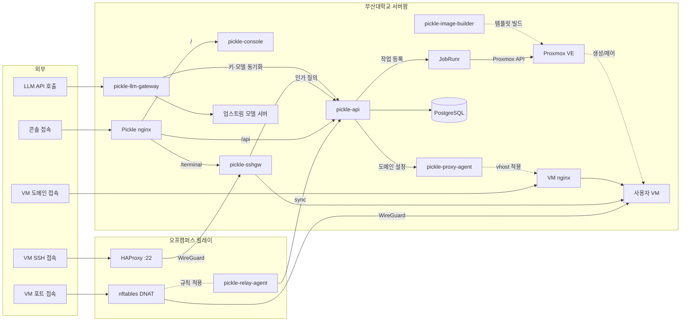

# pickle-llm-gateway

부산대학교 클라우드 플랫폼(Pickle)의 교내 LLM API 게이트웨이예요. 학생 코드가 보내는
OpenAI 호환 요청을 받아 API Key를 검증하고 사용량 한도를 적용한 뒤, 업스트림 모델 서버로
전달해요. 학생이 쓰는 주소는 `https://llm.pcl.kr/v1`이고, 발급받은 Key를 OpenAI SDK의
`base_url`과 `api_key`에 그대로 넣으면 돼요.

## 요청 경로

```
학생 코드 (OpenAI SDK + API Key)
    │  POST /v1/chat/completions, POST /v1/completions, POST /v1/messages, POST /v1/responses, GET /v1/models
    │  POST /v1/images(/generations), GET /v1/images/models, POST /v1/embeddings, POST /v1/rerank
    │  POST /v1/audio/speech, POST /v1/audio/transcriptions
    ▼
llm-gateway ── 키 검증 · 한도 적용 · 모델명 변환 · 사용량 기록
    │
    ▼
업스트림 모델 서버 (OpenAI 호환 API)
```

학생 코드에는 공개 모델명만 보여요. 실제 모델과 업스트림 주소는 게이트웨이 설정에만
있으므로, 업스트림을 교체해도 학생 코드는 바뀌지 않아요.

아래는 패스스루 경로예요. 요청 본문을 그대로 외부 공급자에게 전달하고 응답을 그대로
돌려줘요. 전부 유료 모델이므로 비용은 그 Key에 부여된 금액 한도에서 나가요. Key마다
허용된 경로만 열리고 기본적으로 모두 닫혀 있어요.
패스스루 POST 요청에는 `model`이 필요해요.

| 경로 | 필요한 기능 |
|---|---|
| `POST /v1/images` | 이미지 생성 (`images`) |
| `POST /v1/images/generations` | 이미지 생성 (`images`) |
| `GET /v1/images/models` | 이미지 생성 (`images`) |
| `POST /v1/embeddings` | 임베딩 (`embeddings`) |
| `POST /v1/rerank` | 리랭크 (`rerank`) |
| `POST /v1/audio/speech` | TTS (`speech`) |
| `POST /v1/audio/transcriptions` | STT (`transcriptions`) |
| `POST /v1/batches`, `GET /v1/batches`, `GET /v1/batches/{id}`, `DELETE /v1/batches/{id}` | 배치 (`batches`)와 배치가 보내는 경로의 기능. OpenRouter 형식 |
| `POST /v1/messages/batches`, `GET /v1/messages/batches`, `GET /v1/messages/batches/{id}`, `GET /v1/messages/batches/{id}/results`, `DELETE /v1/messages/batches/{id}` | 배치 (`batches`, `chat`). Anthropic SDK의 `messages.batches` 형식 |
| `POST /v1/videos`, `GET /v1/videos/{id}`, `GET /v1/videos/{id}/content`, `GET /v1/videos/models` | 동영상 생성 (`videos`). OpenRouter 형식 |

`POST /v1/rerank`는 OpenAI나 Anthropic이 아니라 Cohere, Voyage 같은 API의 리랭크 호출이에요. 질의와 문서 목록을 받아
관련도 순서를 돌려줘요. 사용량은 응답의 `usage`에서 읽되 업스트림 문서상 선택 필드이고, 모델에 따라 토큰 수
(`total_tokens`)와 금액이 오거나 토큰 없이 검색 단위(`search_units`)와 금액만 와요. 토큰이 없으면 0으로 기록하고 본문
크기로 추정하지 않아요. 금액이 없으면 응답 본문의 `id`로 생성 기록을 조회해 채워요(이 경로는 `X-Generation-Id` 헤더가
없어요). 응답의 `model`은 서빙 공급자의 원래 이름(예: `rerank-v3.5`)이라 요청한 이름과 비교하지 않고, 기록의 모델 이름은
요청한 이름이에요.

`POST /v1/audio/speech`는 OpenAI SDK의 `audio.speech.create()`가 부르는 음성 합성 경로예요. 응답은 JSON이 아니라
음성 파일이고, 공급자의 미디어 타입(`audio/mpeg`, `audio/pcm;rate=24000;channels=1` 등)을 해석해 다시 적은 값으로
그대로 돌려줘요. 오디오가 아닌 응답은 502 `upstream_error`로 처리해요. 공급자는 mp3와 pcm만 만들고 `response_format`을 빼면
pcm(헤더 없는 원시 PCM)을 돌려주므로, `response_format`이 그 둘이 아니면 400으로 이유와 함께 거절해요.
`stream_format`은 `audio`만 받고(공급자는 늘 파일 하나로 답해요) 참조 음성으로 목소리를 만드는 `input_references`는
거절해요. 응답에 사용량이 없으므로 토큰 0으로 기록하고 금액은 `X-Generation-Id`로 생성 기록을 조회해 채워요.

`POST /v1/audio/transcriptions`는 음성 인식 경로예요. 공급자 형식의 JSON 본문(`input_audio`에 base64 `data`나
`url`)과, OpenAI SDK의 `audio.transcriptions.create()`가 보내는 multipart 업로드(`file` 파트)를 모두 받아요.
multipart는 그대로 넘기지 않고 해석한 뒤 아는 필드(`model`, `language`, `prompt`, `response_format`, `temperature`,
`timestamp_granularities[]`, `keyterms[]`, `diarize`, `provider`, `source_url`)와 파일 하나로 다시 조립해 보내요.
`stream`은 읽어서 `true`면 다른 패스스루 경로처럼 거절해요. 모르는 필드는 400 `unsupported_parameter`, 반복될 수 없는
필드가 반복되거나 UTF-8이 아닌 값은 400 `invalid_parameter_value`, 이름 있는 파트로 읽을 수 없는 본문은 400
`invalid_multipart_form`으로 거절해요. 큰 업로드는 이미지 편집처럼 패스스루 큰 본문
슬롯(기본 2개)을 호출이 끝날 때까지 잡으므로, 수업에서 동시에 많이 쓰면 `LLMGW_PASSTHROUGH_MAX_IN_FLIGHT`를 함께 정해요.
공급자는 `json`과 `verbose_json`만 돌려주므로 `response_format`이 그 둘이 아니면 400으로 이유와 함께 거절하고,
공급자가 받지 않는 `chunking_strategy`와 `include`도 거절해요. 사용량은 시간 과금 모델이면 `seconds`와 `cost`만 와서
토큰 0과 금액으로, 토큰 과금 모델이면 `input_tokens`, `output_tokens`와 `cost`로 기록해요. 금액이 없으면
`X-Generation-Id`로 생성 기록을 조회해요.

`/v1/chat/completions`도 기능 권한 `chat`이 있는 Key에만 열려요. 자체 서빙 모델과 유료 모델
모두에 적용되고, 채팅 없이 다른 기능만 쓰는 Key가 있기 때문에 기본으로 부여하지 않아요.
`GET /v1/models`는 비용이 없으므로 기능 권한 없이 열려요.

`GET /v1/models` 목록에는 자체 서빙 모델과 스냅샷 카탈로그 모델 뒤에, 그 Key로 실제로 부를 수 있는
유료 모델이 이름 순으로 붙어요. 유료 모델은 게이트웨이가 패스스루 업스트림의 공개 카탈로그
`GET {BaseURL}/models?output_modalities=all`를 인증 없이 30분마다 읽어 둔 사본에서 가져와요. 읽기에
실패하면 1분부터 두 배씩 늘려 다시 읽고(최대 30분), 그동안은 마지막으로 읽은 사본을 그대로 써요.
한 번도 읽지 못했으면 목록에는 스냅샷 모델만 나와요. 스냅샷이 패스스루 업스트림을 바꾸면 옛
사본은 쓰지 않고, 옛 업스트림의 재시도 간격과 상관없이 1분 안에
새 업스트림의 카탈로그를 읽어요. 사본 상태는 관리 리스너 `/metrics`의
`vendorModelCatalog`에서 볼 수 있어요(모델 수, 연속 실패 수, 사본이 있으면 경과 초).

유료 모델은 아래 조건을 모두 만족할 때 목록에 나와요.

- 단건 조회 `GET /v1/models/{id}`와 같은 판정을 통과해요. Key에 패스스루 업스트림 자격증명이 있고,
  모델 허용 목록과 금액 축 허용 목록, 차단 목록이 그 이름을 막지 않아야 해요.
- 모델의 출력 중 하나에 필요한 기능 권한이 Key에 있어요. 텍스트는 `chat`, 이미지는 `images`,
  임베딩은 `embeddings`, rerank는 `rerank`, 음성 합성은 `speech`, 음성 인식은 `transcriptions`가
  필요해요. 영상처럼 이 표에 없는 출력만 내는 모델은 나오지 않아요.
- 라우터 이름(`openrouter/*`)과 `:free` 변형은 제외해요.

항목은 표준 필드에 컨텍스트 길이만 더해요. OpenAI 응답에는 `context_length`, Anthropic 응답에는
`max_input_tokens`와 `max_tokens`를 넣어요. 카탈로그에 값이 없거나 0인 필드는 생략해요. 가격, 모달리티, 지원
파라미터는 공급자 확장이라 싣지 않아요. 자체 서빙 모델 항목은 표준 필드만 그대로 둬요.

```json
{"id":"openai/gpt-4o-mini","object":"model","created":1721260800,"owned_by":"openai","context_length":128000}
```

단건 조회는 목록보다 넓어요. 카탈로그에 없는 이름이나 위 기능 권한이 없는 모델도 판정을 통과하면
응답해요. 카탈로그에 있는
이름이면 목록과 같은 항목으로 답해요. 공급자 전용 조회 경로 `/v1/models/{author}/{slug}/endpoints`,
`/v1/embeddings/models`, `/v1/tools`는 지원하지 않으며 인증 전에 404 `unknown_endpoint`로 답해요.
`/endpoints` 경로는 끝의 `/`와 대소문자가 달라도 같이 막아요.

`POST /v1/messages`는 Anthropic Messages API 경로예요. Claude Code와 Anthropic SDK가 이 경로를
부르고, Key는 `Authorization: Bearer`나 `x-api-key`로 받아요. 기능 권한은 `chat`이 필요해요. 유료 모델은
공급자의 `/messages`로, 자체 서빙 모델은 **그 모델의 주 업스트림이 `LLMGW_UPSTREAM_<REF>_MESSAGES=open`일
때만** 업스트림의 `/messages`로 전달해요. 닫힌 업스트림(기본)의 자체 서빙 모델은 400
`model_not_available_on_route`로 거절해요. 자체 서빙 경로의 규칙은 아래와 같아요.

- **필드**: `model`, `messages`, `system`, `max_tokens`, `stop_sequences`, `stream`, `temperature`,
  `top_p`, `top_k`, `tools`, `tool_choice`만 전달해요. `thinking`, `output_config`, `metadata`,
  `context_management`, `service_tier`는 지우고 보내요. 추론 여부는 업스트림 기본값을 따라요. 그 밖의
  필드도 지우고 보내요. 지운 필드 이름은 로그에 남기고 `/metrics`의 `messagesFieldsStripped`로 세요.
  추론 스위치인 `chat_template_kwargs`, `thinking_token_budget`만 이름을 밝혀 400
  `unsupported_parameter`로 거절해요.
- **도구**: 클라이언트가 실행하는 도구(`name`, `description`, `input_schema`, `cache_control`,
  `strict`, `type: custom`)만 받아요. 서버 도구와 Chat 모양의 도구는 400 `invalid_parameter_value`로 거절해요.
- **출력 상한**: 모델 최대값보다 큰 `max_tokens`는 거절하지 않고 최대값으로 낮춰요.
- **입력 한도**: 업스트림 토크나이저로 센 입력(`system`, `tools`, `messages`)이
  `LLMGW_UPSTREAM_<REF>_MESSAGES_MAX_INPUT_TOKENS`(기본 65536)를 넘으면 400 `input_too_long`으로
  바로 거절해요. 문구는 `prompt is too long: N tokens > M maximum.`으로 시작하고 대화를 압축하라는
  안내가 이어져요. 본문 바이트가 한도보다 충분히 작으면 세지 않고, 세기가 실패하면 통과시켜요
  (업스트림의 문맥 한도는 그대로 남아요).
- **동시 턴**: 업스트림 하나에서 동시에 처리하는 턴을 모든 Key를 합쳐
  `LLMGW_UPSTREAM_<REF>_MESSAGES_MAX_CONCURRENT`(기본 8)개로 묶어요. 넘는 턴은
  `LLMGW_UPSTREAM_<REF>_MESSAGES_QUEUE_WAIT`(기본 60s)까지 기다리고, 그래도 자리가 없으면 429
  `agent_busy`와 `Retry-After: 10`으로 답해요. 기다리는 턴은 한도 수만큼만 받아요. 자리는 응답이
  끝까지 전달될 때까지 잡아요.
- **긴 Chat**: 같은 업스트림의 자체 서빙 모델로 가는 Chat 요청도 입력이
  `LLMGW_UPSTREAM_<REF>_MESSAGES_CHAT_INPUT_TOKENS`(기본 32768) 이상이면 같은 자리를 하나 잡아요.
  긴 Chat의 prefill은 에이전트 턴과 같은 무게라서요. 입력은 업스트림의 `/tokenize`(기본 URL 끝의
  `/v1`을 뗀 자리)로 세고, 본문 바이트가 기준보다 충분히 작으면 세지 않아요. 세기가 실패하면 자리 없이
  보내요(`/metrics`의 `chatCountFailures`). 자리가 없으면 같은 429 `agent_busy`로 답하고
  `chatLongInputPlaces`가 자리를 잡은 긴 Chat 수예요. 폴백이 있는 모델의 주 업스트림이 쉬는 중이면 세지도
  자리를 잡지도 않아요. 그 밖에는 폴백이 응답하더라도 주 업스트림의 자리를 응답이 끝날 때까지 잡아요. 짧은
  Chat은 이 한도와 무관해요.
- **폴백**: 폴백 업스트림으로 보내지 않아요. 주 업스트림이 쉬는 동안의 턴은 실패해요.
- **사용량**: `input_tokens`, `cache_read_input_tokens`, `cache_creation_input_tokens`를 더한 값을 입력
  토큰으로 기록하고 분당 토큰과 일일 토큰 한도에 써요. 캐시에서 읽은 값은 캐시 입력으로 따로
  기록해요. 사용량 없이 끊긴 응답은 추정치(표시됨)로 기록해요. 입력을 셌다면 센 값을 써요.

`POST /v1/messages/count_tokens`는 인증 뒤, 열린 업스트림의 자체 서빙 모델이면 업스트림 값을 그대로
돌려줘요. 도구 정의는 본 경로와 같은 규칙으로 봐요. 유료 모델, 모르는 모델, 모델을 읽을 수 없는
요청(다른 메서드, 큰 본문, JSON 아님)은 404 `unknown_endpoint`이고 클라이언트는 자체 추정으로 넘어가요.
세기는 기록하지 않고 Key 한도에도 넣지 않아요.

`POST /v1/responses`는 OpenAI Responses API 경로예요. Codex와 OpenAI SDK의 `responses.create()`가
이 경로를 불러요. 기능 권한은 `/v1/chat/completions`와 같은 `chat`이고 **유료 모델만** 받아요.
자체 서빙 모델 이름은 400 `model_not_available_on_route`로 거절해요. 요청과 응답은 번역하지 않고
모델 이름만 바꿔 공급자의 `/responses`로 그대로 전달해요.

- **응답을 저장하지 않아요.** 저장이나 이전 응답
  참조가 필요한 요청(`store: true`, `previous_response_id`, `conversation`, `background: true`)은
  필드를 지우지 않고 400 `unsupported_parameter`로 거절해요. 이전 대화는 `input`에 모두 담아
  보내요. `store: false`와 `null`은 통과해요. Codex는 `store: false`를 보내므로 걸리지 않아요.
- **하위 경로는 없어요.** `/v1/responses/{id}`, `cancel`, `input_items`, `compact`는 저장된 응답을
  읽는 경로라 인증 전에 404 `unknown_endpoint`로 답하고 기록하지 않아요.
- **필수 필드**는 `model`과 `input`이고, 출력 상한은 `max_output_tokens`로 지정해요.
- **펜스**는 Chat과 같은 자리(`models`, `tools`, `tool_choice`, `plugins`, `preset`, `:online`)에
  더해 `deferred_tools`와 `input` 항목 안의 `tools` 목록을 봐요. 문자열도 목록도 아닌 `input`은
  판정할 수 없어 400 `invalid_parameter_value`로 거절해요. Codex의 `additional_tools`와
  `tool_search_output` 항목도 확인해요. Codex가 기본으로 넣는 `web_search` 도구는
  `web_search` 권한이 없는 Key에서 403 `endpoint_not_allowed`로 거절돼요. Codex 설정에서
  `web_search = "disabled"`로 끄면 빠져요.
- **요청 헤더**는 Chat과 같은 셋만 전달해요. Codex가 붙이는 자기 세션과 턴 헤더는 전달하지
  않아요. 응답에는 `X-Generation-Id`를 중계해요.
- **스트림**은 `data:` 줄만 쓰고 이벤트 종류는 데이터의 `type`으로 구분해요. 업스트림이 `event:`
  줄을 보내도 데이터의 `type`으로 읽어요. 모델 이름은 응답 객체 안이든 이벤트 최상위든 있는
  자리에서 바꾸고, 모든 이벤트는 해석한 값을 다시 직렬화해 보내요.
  `type` 없이 `error` 객체만 담긴 이벤트도 공급자 오류로 보고 끝내요. `response.completed`, `response.incomplete`,
  `response.failed`, `error` 가운데 하나가 오면 응답이 끝난 것으로 보고, 업스트림이 `[DONE]`을
  보냈든 안 보냈든 그 뒤에 `data: [DONE]` 하나를 붙여요. 게이트웨이가 스트림 도중에 끊을 때는
  `{"type":"error","code":...,"message":...}` 이벤트 뒤에 `[DONE]`을 써요.
- **사용량**은 `response.completed`(비스트림은 응답 객체)의 `usage`에서 읽어요. `input_tokens`는
  캐시 입력을 포함한 값이고 `input_tokens_details.cached_tokens`, `output_tokens_details.reasoning_tokens`,
  `cost`를 함께 기록해요. `response.incomplete`(출력 상한에 걸려 끊긴 응답)는 사용량이 있으면
  정상 종료로 기록하고, `response.failed`와 스트림 안의 `error`는 업스트림 오류로 기록해요.
  사용량이 없는 응답은 추정하지 않고 그대로 돌려준 뒤 `upstream_usage_missing`으로 기록해요.
  본문 보관은 이 경로에서 하지 않아요.

`POST /v1/completions`는 OpenAI의 레거시 텍스트 완성 경로예요(OpenAI SDK의 `completions.create()`).
기능 권한은 `chat`이고 **유료 모델만** 받으며, 자체 서빙 모델 이름은 400 `model_not_available_on_route`로
거절해요. 필수 필드는 `model`과 `prompt`이고, 출력 상한은 `max_tokens`와 `max_completion_tokens`를 읽어 작은 값을 `max_tokens`로 보내요. 요청과 응답은 모델 이름만
바꿔 공급자의 `/completions`로 전달하고, 펜스와 요청 헤더, 사용량(`usage`의 토큰과 `cost`, 스트림은 마지막
청크), 스트림의 `[DONE]` 처리는 Chat과 같아요. 공급자는 사용량 청크에도 선택지(`choices`)를 실어 보내므로,
`stream_options.include_usage`를 요청하지 않은 클라이언트에는 그 청크를 `usage`만 빼고 전달해요. 공급자가
`prompt`를 채팅 메시지로 바꿔 채팅 모델에 보내므로 원문을 그대로 이어 쓰는 동작은 보장되지 않고, 사고하는
모델은 출력이 `reasoning`으로 가고 `text`가 빌 수 있어요. 사용량이 없는 응답은 추정하지 않고
`upstream_usage_missing`으로 기록하며 본문 보관은 하지 않아요.

허용되지 않은 경로는 403 `endpoint_not_allowed`로 답해요. 경로가 없는 것과 Key에 허용되지
않은 것은 다른 상태이므로 404로 감추지 않아요. 거절 문구는 경로가 아니라 기능 이름으로
말하고 신청 방법을 함께 알려줘요.

`POST /v1/images/generations`는 OpenAI SDK의 `images.generate()`가 보내는 경로예요. 외부
공급자의 경로는 `/images`라서, 같은 경로를 SDK 이름으로도 받는 것이에요. 기능 권한, 모델
펜스, 사용량 기록, 상한은 `/v1/images`와 같고 본문과 응답도 그대로 전달해요. 다만 공급자가
조용히 무시해 학생이 요청과 다른 결과를 받게 되는 OpenAI 필드는 이 경로에서 400
`unsupported_parameter`로 거절해요.

- `response_format: "url"`: 공급자는 언제나 base64로 돌려주므로 `data[].url`이 비어 와요.
  `b64_json`은 통과해요.
- `style`: 효과가 없어요. 원하는 스타일은 `prompt`에 적어요.
- `moderation`: 공급자는 OpenAI 모델에 한해 `provider.options.openai.moderation`으로만 받아요.

`partial_images`는 스트림에서만 의미가 있고 이 경로는 스트림을 받지 않으므로 거절하지
않아요.

OpenAI SDK의 `images.generate()`는 `b64_json`으로만 동작하고 URL 응답은 지원하지
않아요. SDK의 편집과 변형 경로(`/images/edits`, `/images/variations`)도 열지 않아요. 참조
이미지로 편집하려면 이 경로의 `input_references`에 이미지를 담아 보내요.

패스스루 요청 JSON의 중복된 최상위 필드는 마지막 값으로 판정해요.
업스트림에도 그 값을 다시 직렬화해 보내요.

## 주요 기능

이 게이트웨이가 맡는 부분은 아래와 같아요.

- **API Key 검증**: 발급된 Key만 통과시키고, 폐기와 정지, 만료 상태를 반영해요.
- **사용량 한도**: 자체 서빙 모델은 Key마다 분당 요청 수와 토큰, 동시 요청 수,
  일일 토큰을 제한해요. 유료 모델에는 금액 한도를 적용해요.
- **모델 이름 분리**: 요청과 응답의 모델명을 공개 이름으로 유지해요.
- **기능 권한**: 채팅과 패스스루 경로는 Key마다 기능 단위로 열어요. 부여된 기능이 없으면
  모델 목록 조회 말고는 한 경로도 열리지 않아요. 채팅 안에서 요금이 따로 붙는 기능(웹 검색,
  유료 PDF OCR, 이미지 출력)은 요청 본문에서 판정해 그 기능의 권한을 따로 요구해요.
- **사용량 계측**: 요청마다 토큰 사용량과 처리 결과를 기록해요. 프롬프트와 응답 본문은
  기록하지 않아요.
- **본문 보관(선택)**: Key마다 따로 켤 수 있고 기본은 꺼져 있어요. 켠 Key의 요청과 응답
  본문만 관리 API로 전달해요.

## 동작 방식

인증 상태는 스냅샷 문서 한 개로 관리해요. 어떤 Key가 있고 어떤 모델을 서빙하며 한도가
얼마인지가 JSON 문서 하나에 들어 있고, 게이트웨이는 이 문서를 통째로 읽어 원자적으로
교체해요. 문서가 바뀌면 폴링 주기 안에 반영되므로, Key 폐기는 수 초 안에 적용돼요.
세대 번호가 뒤로 가는 문서는 거부해요.
최고 세대 번호는 문서 옆 `snapshot.json.highwater` 파일에 남으므로, 재시작 뒤에 예전
문서가 되살아나도 거부해요. 모델의 `upstreamRef`가 설정에 없는 업스트림을 가리키면
손으로 관리하는 파일에서는 그 문서의 적재를 거부하고, 관리 API가 준 문서에서는 그 모델
항목만 버려요.

`models`와 `keys` 항목 안의 모르는 필드는 무시해요. 문서 최상위의 모르는 필드는
로컬 파일 모드에서는 적재 오류로 처리하고, 관리 API 모드에서는 무시해요.
모델의 `visibility`가 `RESTRICTED`이면
그 모델을 `allowedModels`에 명시한 키만 접근할 수 있고, 비어 있는 `allowedModels`는
`PUBLIC` 모델만 허용해요. 새 모델을 넣어도 기존 키에 자동으로 열리지 않아요.

모델에는 **예산 축**(`budgetAxis`)이 있어요. `TOKEN`(기본값, 필드가 없으면 이 값)은
자체 서빙 모델의 축으로, **키 단위 한도 넷이 모두 이 축의 모델에만 적용돼요**.
분당 요청 횟수와 분당 토큰 사용량, 동시 요청 수, 그리고 문서의 `quotaExhausted`
플래그(일일 토큰 한도)이에요. 넷 다 자체 서빙 용량을 나누는 장치이고, 유료 모델
호출은 그 용량을 쓰지 않아요. 축은 요청 본문의 모델명으로만 알 수 있으므로
게이트웨이는 본문을 읽은 뒤에 이 한도들을 적용해요. `CREDIT`은 유료 모델의 축으로, 요청에 **그 Key 전용 업스트림
자격증명**(`upstreamCredentials`의 해당 업스트림 항목)이 있어야 하고 금액 한도는 그
자격증명을 발급한 쪽이 강제해요. CREDIT 축에서는 게이트웨이 공용 env 자격증명을
절대 대신 쓰지 않고, 자격증명이 없는 Key는 거절돼요. 그 한도가 다 되면 업스트림은 402나,
OpenRouter라면 Key 한도 초과를 알리는 403(`Key limit exceeded`)으로 답해요. 게이트웨이는 둘 다
`credit_exhausted`(429)로 돌려주고, 재시도하지 않으며 업스트림 장애로 세지도 않아요. 그 밖의
401과 403은 자격증명 거절로 보고 `upstream_error`(502)로 답해요.
축은 모델 행의 속성이지 업스트림 종류가 아니므로, 같은 모델의 업스트림을 교체해도
축은 바뀌지 않아요.

**요청 본문의 최상위 필드도 축이 정해요.** 목록에 없는 이름은 무시가 아니라 거절
(`unsupported_parameter`, 400)로 처리해요.

자체 서빙(TOKEN) 축에서 허용하는 최상위 필드예요.

```
model  messages  stream  stream_options  max_tokens  max_completion_tokens
temperature  top_p  stop  presence_penalty  frequency_penalty  seed  user
response_format  tools  tool_choice  parallel_tool_calls
```

TOKEN 축의 `tools`는 클라이언트에서 실행하는 `type: function` 도구만 받아요.
도구와 함수 정의에는 표준 필드만 허용하며, 함수의 `parameters`는 JSON Schema 데이터로
그대로 전달해요. 함수 이름이나 스키마 속성 이름으로 서버 기능을 판정하지 않아요.
`tool_choice`는 `auto`, `none`, `required`와 정의된 함수의 명시 선택,
`allowed_tools`의 함수 선택 목록을 받아요. 도구 정의와 선택 구조의 중복 필드나
지원하지 않는 도구 형식은 400 `invalid_parameter_value`로 거절해요.
이 검사는 스트리밍과 일반 응답, 기본 업스트림과 폴백에 공통으로 적용돼요.

**자동 선택 모델은 지원하지 않아요.** `openrouter/` 아래 이름은 **모델을 고르는 이름**이라 어떤
모델이 답할지 요청 시점에 정해지지 않고, 외부 공급자는 **고른 모델 기준으로 청구**해요. 공급자
전용 기능이므로 **모든 Key에서 거절해요.**

- 요청의 `model`에 적힌 라우터 이름은 400 `router_not_supported`로 거절해요. Chat, Messages,
  Responses, 패스스루 경로가 같아요. 단건 조회는 404로 답하고 목록에는 나오지 않아요.
- 폴백 후보, 서버 도구, 플러그인에 적힌 라우터 이름은 그 필드의 거절(403 `model_not_allowed`)로
  막고, 문구에 필드 이름을 함께 적어요.
- Key에 카탈로그 모델 목록(`allowedModels`)이 있으면 유료 모델 이름은 모두 그 목록에서 먼저 막히므로
  403 `model_not_allowed`가 돼요.
- 거절 문구는 목록을 보라고 하지 않고 **일반적인 LLM API가 제공하는 모델 이름을 직접 지정하라**고
  알려요.
- 자체 서빙(TOKEN) 카탈로그 항목은 이름이 같은 접두로 시작해도 라우터가 아니므로 이 규칙과 무관해요.

벤더 접두사 전체를 막으므로, 같은 접두사의 실제 모델도 사용할 수 없어요.

**아래의 서버 도구와 기능 권한 규칙은 유료(CREDIT) 축에 적용돼요.**
TOKEN 축은 위의 함수 도구 형식을 따라요.

`tools`가 부르는 모델도 같은 펜스를 지나요. 공급자의 서버 도구 일부가 본문 안에서 다른 모델을
부르는데(`parameters.model`, Messages 경로에서는 도구 최상위의 `model`), 두 자리 모두 후보
목록과 같은 규칙으로 판정해요. **이미지 생성
도구는 `images` 기능 권한도 함께 요구해요.** 웹 검색 도구(`openrouter:web_search`)는
`web_search` 기능 권한을 요구해요. 중첩된 도구 목록 안에 있어도 같아요.
`namespace` 도구가 묶은 도구(`tools`)와 `tool_choice`가 `type`으로 지정한 도구(`{"type":"web_search"}`,
`allowed_tools`의 `tools` 목록)도 같은 규칙으로 판정해요. 도구를 정의하지 않고 `tool_choice`로만
불러도 같은 권한이 필요해요.

**공급자 전용 서버 도구는 아는 것만 받아요.** `openrouter:` 접두가 붙은 도구 가운데 이 게이트웨이가
아는 것(`web_search`, `image_generation`, `advisor`, `fusion`, `subagent`, `web_fetch`, `tool_search`,
`apply_patch`, `datetime`, `experimental__search_models`, `shell`, `bash`)만 위 규칙으로 판정하고,
나머지는 400 `unsupported_parameter`로 거절해요. `openrouter:files`도 거절해요.
접두가 없는 표준 도구(`function`, `custom`, `mcp`, `file_search`, `computer_use_preview` 등)는 CREDIT 축에서 그대로
통과해요.

**샌드박스에서 명령이나 코드를 실행하는 서버 도구(`openrouter:shell`, `openrouter:bash`,
`local_shell`, `code_interpreter`)는 `containers` 기능 권한을 요구하고, 이 권한은 아직 부여하지 않아요.** 그래서 지금은 CREDIT 축에서도 403
`endpoint_not_allowed`로 거절하고, 거절 문구는 신청 대신 도구를 빼고 다시 보내라고 안내해요.
공급자의 컨테이너는 Key가 아니라 공급자 계정 단위로 묶이고, 어느 컨테이너를 쓸지는 요청에서
정해져요. 호출자가 고른 id(`container_reference`)나 `session_id`, `X-Session-Id` 헤더,
`prompt_cache_key`에서 유도한 id예요. 같은 계정 아래의 두 Key가 같은 id에 닿으면 서로의 파일을
읽고 쓸 수 있으므로, Key마다 컨테이너를 따로 쓰게 될 때까지 도구 쪽을 막아 둬요. 세션 값과
`prompt_cache_key`는 그대로 전달해요. 컨테이너가 없으면 프롬프트 캐시용 공급자 고정에만
쓰이기 때문이에요. 같은 도구가 지정한 모델도 거절 대상이면 이 거절이 먼저예요. `local_shell`은
표준 API에서는 클라이언트가 실행하는 도구지만, 공급자는 자기가 직접 서빙하지 않는 모델에서 이 도구를
샌드박스로 보낸다고 문서화했어요. `code_interpreter`는 호스팅 컨테이너에서 코드를 실행해요.

**공급자는 서버 도구 하나를 여러 `type` 철자로 받아요.** `openrouter:web_search` 말고도
`web_search`, `web_search_preview`, `web_search_preview_2025_03_11`, `web_search_2025_08_26`가
Chat에서 같은 유료 검색을 실행하고, Messages에서는 `web_search_20250305` 같은 Anthropic 철자와
`advisor_20260301`, `image_generation`이 그래요. 그래서 `type`에서 `openrouter:` 접두와 날짜
접미사(`_20250305`, `_2025_03_11`)를 뗀 기본 이름으로 어떤 도구인지 정한 뒤 판정해요. 기본
이름이 `web_search`, `image_generation`, `advisor` 등으로 시작하면 그 도구로 봐요.
`web_fetch`는 권한 없이 통과하고, `code_execution_*`는 공급자가 400으로 거절하므로 그대로
보내요. `shell`, `shell_<날짜>`는 `openrouter:shell`로, 날짜 없는 `bash`는 `openrouter:bash`로
봐요. `bash_20250124` 같은 날짜 붙은 `bash`는 공급자 문서가 명령을 애플리케이션에 돌려주는
클라이언트 도구로 설명하므로 서버 도구로 보지 않고 통과시켜요. `apply_patch`는 패치를
애플리케이션이 적용하는 도구라 컨테이너를 쓰지 않으므로 권한 없이 통과해요.

모델 제한이 걸린 Key에서는 **모델을 비워 둔 서버 도구도 거절해요.** `openrouter:advisor`(와
`advisor_20260301`)는 `model`이 도구 최상위에도 `parameters`에도 없으면 답을 만드는 모델이 생성 도중에 자문 모델을 고르고,
`openrouter:fusion`은 `model`과 `analysis_models`가 없으면 공급자 기본값을 써요. 어느 쪽도
요청에 이름이 드러나지 않아 판정할 수 없어요. `openrouter:subagent`는 모델이 없으면 요청의
`model`을 쓰므로 그대로 통과해요. 도구가 안쪽 호출용으로 다시 받는 `parameters.tools`도 같은
규칙으로 판정해요.

**`plugins`도 펜스를 지나요.** `fusion` 플러그인의 `model`과 `analysis_models`는 같은 규칙으로
판정하고, 공급자 쪽에서 모델 묶음으로 펼쳐지는 `preset`은 모델 제한이 걸린 Key에서 거절해요.
라우터 플러그인(`auto-router`, `auto-beta-router`, `pareto-router`, `jev-router`,
`switchyard-router`)은 모델 제한이 걸린 Key에서 거절해요. 후보가 와일드카드나 점수라 판정할 수
없기 때문이에요. 그 설정을 읽는 라우터 모델(`openrouter/*`)은 이제 어느 Key에서도 쓸 수 없어서,
제한이 없는 Key가 보낸 라우터 플러그인은 설정할 대상이 없어요.
`context-compression`은 모델 이름을 받지 않고 작은 컨텍스트 모델에서는 지정하지 않아도 켜지므로
판정 대상에 넣지 않았어요.

**`preset`도 거절해요.** preset은 모델과 폴백 목록을 통째로 담을 수 있어 펜스가 읽는 필드
바깥에서 판정을 지나가요. 최상위 `preset` 필드, `@preset/slug` 모델명, `모델@preset/slug`
형태 셋 다 막아요. **모델 제한이 없는 Key에서도 막아요.**

**차단 목록은 `~`를 제거한 이름도 검사해요.** `anthropic/*`를 차단하면
`~anthropic/claude-sonnet-latest`도 차단돼요. 허용 목록에서 공급자를 직접 지정할 때는
`anthropic/*`와 `~anthropic/*`를 구분해요. 공급자 자리 전체를 `*`로 지정하면 두 이름을
모두 포함해요.

**공급자 접두 없는 `claude-` 이름은 `anthropic/`을 붙인 이름으로도 판정해요.** 공급자가
Messages 경로에서 `claude-opus-5-5`(없는 날짜를 붙인 이름까지)를 `anthropic/claude-opus-5.5`로
해석해 그 모델 값으로 청구하기 때문이에요. 요청의 이름은 바꾸지 않고 판정만 두 이름으로 해요.
허용 목록은 둘 중 하나라도 맞으면 허용, 차단 목록은 둘 중 하나라도 맞으면 차단이고 차단이
우선해요. 그래서 `anthropic/*` 차단은 `claude-opus-5-5`도 막고, `anthropic/claude-opus*` 허용은
그 이름을 열어요. 다른 접두 없는 이름은 적힌 그대로만 판정해요.

**`models`는 예외예요.** 목록에 적힌 이름은 외부 공급자가 `model` 대신 서빙하고 **그
이름으로 청구**할 수 있어요. 목록의 **모든 항목에 모델 제한과 예약 접두 규칙을 적용**하고,
하나라도 걸리면 그 이름을 말하며 거절해요. 허용된 모델 사이의 폴백은 사용할 수 있어요.

`model` 없이 `models`만 보내도 돼요. 공급자 문서가 정한 모양으로, 첫 항목이 주 모델이에요.
게이트웨이는 첫 항목을 `model`과 똑같이 판정하고(이름 규칙, 예산 축, 모델 펜스, 자격증명),
목록 전체에도 위의 펜스를 그대로 적용해요. 업스트림에는 학생이 보낸 모양 그대로
`model` 없이 목록만 보내고, 첫 항목만 실제 업스트림 모델 이름으로 바꿔요.

**유료(CREDIT) 축에는 그 밖의 허용 목록이 없어요.** 최상위 필드는 그대로 외부 공급자에게
가요. `reasoning_effort`, `verbosity`, `reasoning` 객체, 라우팅과 플러그인, 캐싱 제어,
공급자가 나중에 추가하는 필드도 사용할 수 있어요.

**요청 헤더는 유료 모델의 채팅 요청에서 셋만 전달해요.** `x-anthropic-beta`(Anthropic 베타 기능,
예: strict 도구 사용), `x-session-id`(프롬프트 캐싱을 위한 공급자 고정), `X-OpenRouter-Metadata`(응답
본문에 이 요청의 공급자 선택과 폴백 과정을 싣는 옵션)이에요. 마지막 것은 조직 가드레일 판정도 함께
실으므로, 조직이 가드레일을 쓰기 시작하면 다시 판단해야 해요. 값이 1 KiB를 넘으면
버려요. 자체 서빙 모델에는 어떤 헤더도 전달하지 않아요. 일부러 전달하지 않는 것은 둘이에요.

- 앱 귀속 헤더(`HTTP-Referer`, `X-OpenRouter-Title`, `X-Title`, `X-OpenRouter-Categories`): 공급자가 귀속된
  트래픽을 공개 순위와 앱 페이지에 싣고, 앱을 계정이 아니라 URL로 묶어요. 전달하면 학생 한 명이
  플랫폼 계정의 트래픽을 아무 URL 아래에, 남의 앱 아래에도 공개할 수 있어요.
- 응답 캐싱(`X-OpenRouter-Cache`, `-Cache-TTL`, `-Cache-Clear`): 캐시 적중은 토큰 0, 금액 0의 정상
  응답처럼 보이고 응답 헤더로만 구별돼요. 사용량 기록이 적중을 표시하기 전까지는 열지 않아요.

**응답 헤더는 둘만 돌려줘요.** 유료 모델의 성공 응답에는 공급자의 생성 id(`X-Generation-Id`)를,
공급자가 429나 503으로 답할 때는 게이트웨이의 오류 응답(429는 503 `server_busy`, 503은 502
`upstream_error`)에 공급자가 정한 대기 시간(`Retry-After`, 1시간 이하의 초)을 실어 보내요. 폴백
업스트림까지 시도했으면 가장 긴 대기 시간이에요. 이미지와 임베딩 경로도 같아요. 계정 전체의 한도를 말하는 `X-RateLimit-*`, 계정 예산이 찼을
때의 402에 붙는 `Retry-After`, 캐시 헤더는 돌려주지 않아요.

**TOKEN 축에서 `verbosity`는 계속 거절하고, `reasoning_effort`는 업스트림 설정이 정해요.**
`LLMGW_UPSTREAM_<REF>_REASONING`이 `closed`(기본)면 지금처럼 거절하고, `effort`면 그대로 전달하고,
`template`이면 `reasoning_effort`를 지우고 채팅 템플릿의 사고 스위치(`chat_template_kwargs.enable_thinking`,
`none`이면 끔, 그 밖은 켬)로 바꿔 보내요. `budget`이면 같은 스위치에 더해 사고 토큰 예산
`thinking_token_budget`을 넣어요(`minimal`, `low`는 1024, `medium`은 4096, `high`, `xhigh`는 8192). 서빙
프로세스가 예산을 다 쓰면 사고를 끝내고 답을 이어 써요. vLLM은 추론 파서가 켜져 있어야 이 필드를 받아요.
사고 토큰도 출력 상한(`max_completion_tokens`, `max_tokens`) 안에서 세므로, 상한이 예산보다 작으면 답 없이
`length`로 끝날 수 있어요. 게이트웨이가 받는 값은 `none`, `minimal`, `low`, `medium`,
`high`, `xhigh`이고, 그 밖의 값은 `invalid_parameter_value`로 거절하며 `null`은 보내지 않은 것으로 봐요.
`effort` 업스트림에는 값을 그대로 보내므로, 그 업스트림이 모르는 값은 업스트림의 거절로 돌아와요.
`chat_template_kwargs`, `thinking_token_budget`, 공급자의 `reasoning` 객체는 어떤 설정에서도 거절해요.
일반 API 필드가 아니라 특정 서빙의 스위치이고, `template` 업스트림에는 게이트웨이가 직접 넣어요.

허용 여부는 모델의 1차 업스트림 설정으로 판정하고, 실제로 보낼 모양은 시도마다 그 시도의
업스트림 설정을 따라요. 폴백 업스트림이 `closed`면 필드를 빼고 보내요.

**이 설정은 학생이 바꿀 수 있는지만 정해요.** 필드가 없을 때 추론할지는 업스트림의 기본값이에요.
사고를 끈 채 띄운 서빙은 계속 끄고, 기본으로 추론하는 호스팅 모델은 `closed`에서도 추론해요.
모델을 다른
업스트림으로 옮기면 그 업스트림의 결정이 따라가요. 같은 업스트림을 쓰는 자체 서빙 모델은 모두
같은 설정을 받아요. 유료 모델(CREDIT 축)은 같은 업스트림을 써도 이 설정의 영향을 받지 않고
추론 필드를 그대로 전달해요.

추론 토큰은 출력 토큰(`completion_tokens`)에 들어 있으므로 일일 토큰 한도와 분당 토큰 한도에
그대로 잡혀요. 사용량이 오지 않은 응답(중단된 스트림 등)의 추정에도 응답의 추론 텍스트(`reasoning`
또는 `reasoning_content`) 길이를 넣어요. `max_completion_tokens`는 추론과 답을 합친 상한이라, 작게 주면 추론만 하다 빈 답으로
끝날 수 있어요.

**축은 모델의 속성이므로 검사도 모델을 읽은 뒤에 돌아요.** 요청 모양 오류가 권한 오류보다
먼저 오도록, 허용 목록 검사는 축을 안 직후이자 Key의 모델 접근 검사 직전이에요. TOKEN 축에
유료 모델 전용 필드를 보내면 공개 코드는 같은 `unsupported_parameter`이고 안내 문구만 달라요.

자격증명이 없는 이유는 두 가지이고 거절도 둘로 나뉘어요. 금액 한도를 받은 적이 없으면
`credit_unavailable`(403)이고, 한도는 부여됐는데 그 Key의 업스트림 자격증명이 아직
만들어지지 않았으면 `credit_pending`(503)이에요. 뒤쪽은 관리 API가 문서에
`creditPending`으로 표시해 주는 상태이고 저절로 끝나므로, 응답에 `Retry-After`가
실려요. 단 `/v1/messages`에서는 오류 종류를 `overloaded_error`가 아닌 `api_error`로 하고
`x-should-retry: false`를 붙여요. Anthropic SDK와 Claude Code는 이 헤더를 보면 스스로
재시도하지 않아요. `credit_unavailable`에는 재시도 헤더가 없고 한도를 신청해야 해요. 문서에
`creditPending`이 없는 관리 API를 쓰면 두 경우 모두 `credit_unavailable`이 돼요.

문서 최상위의 `passthroughRef`가 설정돼 있으면, 카탈로그에 없는 모델명은 그 업스트림으로
**이름 그대로** 전달돼요(패스스루). 패스스루 모델은 항상 CREDIT 축으로 취급되므로 Key
자격증명이 없으면 거절되고, `pickle-` 접두 이름은 대소문자와 무관하게 패스스루되지 않아요.
공개 모델명은
소문자로 쓰고 조회는 대소문자를 구분하며, `pickle-` 접두는 자체 서빙 모델 전용이에요.
과거에 같은 용도로 쓰던 `pnu-` 접두도 예약이 유지되어 패스스루되지 않아요. API Key
평문도 같은 `pickle-` 접두를 쓰며, Key는 Authorization 헤더로, 모델명은 요청 본문의
`model` 필드로 전달해요.
Key별 자격증명 발급과 갱신은 관리 API 모드의 몫이에요. 손으로 관리하는 파일 모드는 토큰
축 운영을 전제하며, `passthroughRef`를 파일에 쓸 때는 해당 업스트림 env 블록을 먼저
설정해야 해요(없으면 문서 적재가 거부돼요).

Key에는 CREDIT 축 전용 허용 목록 `creditAllowedModels`가 있어요. **비어 있으면 제한이
없고**(금액 한도만이 경계), 비어 있지 않으면 CREDIT 축 모델은 목록에 맞는 이름만 쓸 수
있어요. 모델 자리는 정확한 이름, 전체를 여는 `*`, 접두를 여는 `gpt-5-*`,
접미를 여는 `*-pro`를 받아요. 모델 자리의 별은 한쪽 끝에 하나만 사용해요.
공급자 자리는 정확한 이름 또는 전체를 뜻하는 `*`를 받아요.
`openai/*`, `*/gpt-5`, `*/gpt-5-*`, `*/*-pro`, `*/*`를 사용할 수 있으며,
`open*/*`와 `~*/*`는 거부해요.
별은 빈 문자열도 먹으므로 `openai/gpt-5*`는 `openai/gpt-5` 자체를 포함하고,
`openai/gpt-5-*`처럼 구분자로 끝나는 접두도 그 계열의 이름인 `openai/gpt-5`를
포함해요. 정확한 이름과 접미를 여는 항목은 `:batch`나 `:free` 같은 변형 접미사를 제거한
이름으로도 비교하므로 `openai/gpt-5-pro`와 `*/*-pro`는 모두
`openai/gpt-5-pro:batch`에 맞아요. 접미 항목이 접미사만 남은 이름(`openai/pro`)까지 잡지는
않아요. 판정은 소문자로 내려 비교하므로 대소문자가 다른 이름으로 목록을 우회할 수
없어요(위의 `allowedModels`는 대소문자를 구분해요. 그쪽은 카탈로그 이름의 정확
일치라서 그렇고, 두 목록이 함께 채워지면 더 엄격한 쪽이 답을 정해요). `*` 하나만 적는
것은 허용하지 않아요. 빈 허용 목록은 이름에 제한을 두지 않아요. `*/*`는 공급자가
있는 이름만 포함해요. 라우터 모델은 목록과 관계없이 모든 Key에서 거절해요.

벤더의 부동 별칭(`~anthropic/claude-sonnet-latest`처럼 최신 모델을 가리키는 이름)도
목록에 적을 수 있어요. **허용 목록의 `~anthropic/*`와 `anthropic/*`는 서로를 포함하지 않아요.**
공급자 자리 전체의 `*`는 별칭도 포함하므로 `*/*-pro`는 `~openai/gpt-5-pro`에 맞아요.
판정은 이름으로만 하며, 별칭이 실제로 가리키는 모델을 조회하지 않아요.

차단 목록 `creditDeniedModels`는 허용 목록이 열어 둔 것에서 모델을 다시 빼내요. 항목의
문법은 허용 목록과 같고 `~`를 제거한 이름도 검사해요. **차단이 허용을 이겨요.**
비어 있으면 아무것도 차단하지 않으므로, 두 목록이 다 비어 있는 Key는 금액 한도만이
경계예요. 허용 목록을 벤더 단위로
넓게 쓰고 값이 튀는 이름 몇 개를 차단 목록으로 빼는 것이 이 조합의 쓰임새예요.
차단으로 막힌 호출은 허용 목록에 없어서 막힌 호출과 **같은 응답**을 받아요(403
`model_not_allowed`). 어느 목록 때문인지는 알려주지 않아요.

**두 목록 다 TOKEN 축을 건드리지 않아요.** 목록이 걸린 Key도 자체 서빙 모델은 그대로
써요. 위의
`allowedModels`와 역할이 달라요. 그쪽은 카탈로그 모델을 큐레이트하는 축이라, 채우면
자체 서빙 모델까지 함께 잠겨요.

적재할 수 없는 항목이 하나라도 있으면 **그 Key를 통째로 버려요.** 허용 목록도 차단
목록도 그래요. 잘못된 항목만 빼서 권한을 넓히지 않아요.

Key의 `passthroughEndpoints`는 그 Key의 **기능 권한**이에요. 값은 기능 이름이고 이 게이트웨이가
판정하는 기능은 아래와 같아요. 모르는 이름은 그대로 두고 아무것도 열지 않아요.

| 기능 | 여는 것 |
|---|---|
| `chat` | `POST /v1/chat/completions`(자체 서빙과 유료 모델 모두), `POST /v1/messages`(유료 모델, 그리고 Messages를 연 업스트림의 자체 서빙 모델)와 그 `count_tokens`(자체 서빙 모델만), `POST /v1/responses`, `POST /v1/completions`(이 둘은 유료 모델만) |
| `web_search` | 유료 모델 채팅의 웹 검색. `plugins`의 `{"id":"web"}`, 모델 이름이나 `models` 후보, 서버 도구와 fusion 플러그인이 지정한 모델의 `:online` 접미사, `openrouter:web_search` 도구와 그 다른 철자(`web_search`, `web_search_preview`, `web_search_20250305` 등), OpenAI 표준 `web_search_options` |
| `pdf_ocr` | 유료 모델 채팅의 유료 PDF OCR. `file-parser` 플러그인이 `pdf.engine`으로 `mistral-ocr`를 지정한 요청 |
| `images` | `POST /v1/images`, `POST /v1/images/generations`, `GET /v1/images/models`, 그리고 유료 모델 채팅의 이미지 출력(`modalities`에 `image`, `openrouter:image_generation` 도구와 `image_generation`) |
| `embeddings` | `POST /v1/embeddings` |
| `rerank` | `POST /v1/rerank` |
| `transcriptions` | `POST /v1/audio/transcriptions` |
| `speech` | `POST /v1/audio/speech`, 그리고 유료 모델 채팅의 음성 출력(`modalities`에 `audio`). 음성 입력은 판정하지 않아요 |
| `batches` | `POST /v1/batches`(제출), `GET /v1/batches`(목록), `GET /v1/batches/{id}`(상태와 결과), `DELETE /v1/batches/{id}`(끝난 배치 삭제), 그리고 같은 배치의 Anthropic 형식 `/v1/messages/batches` 경로들. 배치가 보내는 경로의 기능(`chat`이나 `embeddings`)도 함께 있어야 해요 |
| `videos` | `POST /v1/videos`(제출), `GET /v1/videos/{id}`(상태), `GET /v1/videos/{id}/content`(영상 받기), `GET /v1/videos/models`(모델 목록) |
| `containers` | 유료 모델 채팅의 샌드박스 명령과 코드 실행. `openrouter:shell` 도구와 그 다른 철자(`shell`, `shell_<날짜>`, `local_shell`), `openrouter:bash` 도구와 날짜 없는 `bash`, `code_interpreter`. **아직 부여하지 않아요** |

채팅 안의 기능은 **그 기능만을 뜻하는 필드로만** 판정해요. 그 기능을 쓸 수도 있었던 요청은
거절하지 않고, 거절할 때는 요청을 고쳐 넘기지 않고 403으로 답해요. 그래서 판정하지 않는 것이
있어요. 모델 스스로 검색하는 모델, 엔진을 지정하지 않은 PDF를
PDF를 직접 읽지 못하는 모델에 보낸 요청(공급자가 유료 엔진을 기본으로 써요)이에요. 판정할 수
없는 값(`modalities`가 목록이 아니거나 `pdf.engine`이 문자열이 아닌 경우)은 400으로 거절해요.
모델 거절과 기능 거절이 겹치면 모델 거절이 먼저예요.

**기능 목록이 비어 있거나 필드가 없으면 한 경로도 열리지 않아요.** 빈 값이 제한 없음을
뜻하는 모델 허용 목록과 구분해요.

**`chat`도 이 목록에 있으므로, 이 필드를 모르는 관리 API의 문서로는 모든 Key의 채팅이
막혀요.** 관리 API가 모든 기존 Key에 `chat`을 부여한 뒤에 이 게이트웨이를 배포하고, 되돌릴
때는 게이트웨이를 먼저 되돌려요. 관리 리스너의 `/metrics`에 있는 `activeKeysWithoutChat`이
지금 적용된 문서에서 `chat`이 없는 사용 가능한 Key 수예요. 배포 직후와 재시작 뒤에 이 값이
활성 Key 전체와 같으면 `chat`을 모르는 문서가 적용된 것이에요. 이 값으로 집행을 끄지는
않아요. 읽을 수 없는 기능 항목이 있어도 Key 전체를 버리지는 않아요.

각 응답은 `X-Request-Id` 헤더로 그 요청의 기록 식별자를 돌려주므로 문의에 인용할 수
있어요. `/healthz`는 세대와 스냅샷 나이, 리로드 정체 여부를 함께 반환해요.

문서는 두 곳에서 올 수 있어요. 기본값은 운영자가 관리하는 **로컬 파일**이고,
`LLMGW_SNAPSHOT_SOURCE=http`로 두면 **관리 API에서 받아와요**. 관리 API 모드에서는 **적재에 성공한**
문서만 로컬에 캐시하므로, 관리 API가 닿지 않는 동안 재시작해도 마지막으로 실제 적용했던
상태로 기동해요. 문서 형식은 두 경우가 같아요.

적재를 거부한 문서가 다시 제시되면 `/healthz`의 실패 횟수가 올라가요.

**문서 하나가 통째로 거부되면 그동안 폐기와 정지가 반영되지 않아요.** 그래서 관리 API가
준 문서에서는 게이트웨이가 다룰 수 없는 값(모르는 상태 이름, 이 호스트에 설정되지 않은
업스트림)을 만나도 그 항목만 버리고 나머지를 적용하며, 버린 개수를 `/healthz`와 지표에
드러내요. 로컬 파일 모드에서는 같은 상황에 적재를 실패시켜요. 파싱 자체가 안 되는
문서, `serviceEnabled`가 빠진 문서, `models`와 `keys` 중 한쪽이라도 빠진 문서는 어느
쪽에서도 거부해요. 둘 다 빠진 문서도 거부해요. 관리 API의 "변경 없음" 응답은 전송 계층에서
걸러요.

요청 처리는 이렇게 흘러요. Authorization 헤더의 Key를 sha256으로 해시해 스냅샷에서
찾고, 한도를 확인한 뒤 요청 본문의 모델명을 실제 모델로 바꿔 업스트림에 전달해요.
스트리밍 응답은 조각 단위로 그대로 흘려보내면서 모델명만 공개 이름으로 되돌려요.
자체 서빙 모델에서 지원하지 않는 파라미터는 이름을 밝혀 거부하므로, 업스트림을 바꿔도
학생 코드가 보내는 요청의 의미는 달라지지 않아요.

자체 서빙 모델에서 `verbosity`나 닫힌 `reasoning_effort`를 거절할 때는 유료 모델에서
사용할 수 있다고 안내해요.

허용 목록과 별개로 도는 것 넷은 축과 무관하게 그대로예요. 모델명 치환, 스트리밍의
`stream_options.include_usage` 강제, 출력 상한 주입, `pickle-` 예약 접두 가드예요.

토큰 사용량은 업스트림이 돌려주는 usage 값으로 기록해요. 스트리밍 요청은 업스트림에
`stream_options.include_usage`를 강제로 켜서 마지막 조각의 사용량을 받되, 학생이 직접
요청하지 않았다면 그 조각은 계측에만 쓰고 응답으로는 보내지 않아요. 사용량을 얻지
못한 채 끝난 요청은 크기 기반 추정치를 `estimated` 표시와 함께 기록해요. 기록은 하루 단위
JSONL 파일에 쌓여요. 모델을 정상적으로 결정한 요청은 그 시점의 예산 축(`TOKEN` 또는
`CREDIT`)도 함께 기록하며, 모델을 결정하지 못한 요청에는 이 필드가 없어요. 이 파일은
**발송 대기함**이기도 해요. 전송을 켜면 마지막으로
보낸 지점부터 이어서 관리 API로 배치 전송하고, 실패하면 물러섰다 다시 시도해요. 항목마다
고유한 `eventUuid`가 있어 같은 항목이 두 번 도착해도 중복으로 쌓이지 않아요.

새 요청은 업스트림 시도 횟수(`attempts`)를 실제 0과 양수로 구분해 기록해요. 업스트림에
시도하기 전 거절한 요청도 0을 명시해요. 예전 발송 대기 파일에 이 필드가 없거나 null이면
미기록 상태를 유지해 재전송하며 0으로 바꾸지 않아요. 보고된 공급원 이름만으로 접촉이나 생성
성공을 확정하지 않고, 알려진 시도 횟수와 결과를 함께 확인해야 해요.

HTTP 200으로 시작한 스트림에서도 최상위의 null이 아닌 `error`나
`choices[].finish_reason: "error"`를 받으면 사용량 결과를 `UPSTREAM_ERROR`, 오류 유형을
`upstream_error`로 기록해요. 오류 조각은 클라이언트에 전달하며, 이미 사용한 토큰과 금액도
기록해요.

항목은 회계에 필요한 것만 담고 프롬프트나 응답 본문은 어떤 필드에도 담지 않아요. 토큰 수
외에도 요청이 들어온 경로(`endpoint`), 업스트림이 응답한 모델 이름
(`servedModelName`), 업스트림이 보고한 요청 하나의 금액(`costUsd`), 돌아온 이미지 수
(`imageCount`), 캐시에서 나온 입력 토큰과 사고에 쓰인 출력 토큰(`cachedInputTokens`,
`reasoningTokens`), 스트리밍 여부(`streamed`)를 기록해요.

정상으로 끝난 스트림은 Chat, Completions, Messages, Responses 모두 마지막 usage에 금액이 와요. 유료 모델 스트림이 금액
없이 끝나면(클라이언트 연결 끊김, 이벤트 상한 초과, 업스트림 끊김 등) 게이트웨이가 응답을 닫은 뒤
업스트림의 생성 기록(`GET /generation?id=<X-Generation-Id>`)을 그 Key의 자격증명으로 조회해
`total_cost`를 `costUsd`에 채우고 나서 항목을 써요. 토큰 수는 덮어쓰지 않아요. 기록은
스트림이 끝나고 11~12초 동안 404라(2026-10-14 실측) 12초 뒤에 처음 읽고, 404면 18, 28, 43,
58초에 다시 읽어요. 실패한 요청의 기록은 계속 404이므로 60초가 지나면 금액 없이 써요. 조회
한 번은 5초에서 끊어요. 그래서 이런 항목은 보통 12초쯤, 최대 60초 늦게 쌓이고, `latencyMs`에는
이 대기가 들어가지 않아요. 대기 중인 조회는 512개까지이고, 넘으면 그 항목은 금액 없이 바로
써요. 종료 신호를 받으면 남은 조회를 종료 유예(리스너 종료와 합쳐 60초) 안에서 기다리고, 유예가
끝나면 금액 없이 써요. 조회 한도와 유예가 같은 60초라 종료 직전에 끝난 스트림은 대개 금액 없이
기록되며, 이것이 정상 동작이에요. 관리 리스너의 `/metrics`에서 `streamCostFilled`는 조회로 금액을
채운 수, `streamCostMissing`은 못 채운 수예요.

패스스루 경로는 업스트림이 200으로 답해 이미 과금한 뒤 게이트웨이가 응답을 넘기지 못한 요청(응답 상한을 넘어
`upstream_response_too_large`로 거절, JSON이 아니라 `upstream_invalid_response`로 거절, 응답을 읽다 끊김, 클라이언트에게
쓰다 끊김)이 금액 없이 끝나면, 응답을 닫은 뒤 그 응답의 `X-Generation-Id`로 생성 기록을 조회해 `costUsd`를 채워요.
이미지와 임베딩처럼 매 호출에 usage를 보고하는 경로의 성공 응답은 금액이 없어도 조회하지 않아요(호출마다 업스트림
조회가 하나씩 붙기 때문이에요). usage가 선택인 경로는 금액 없는 응답을 모두 조회해요. 비채팅 호출의 생성 기록은 더 늦게
나와서(2026-10-21 실측, 음성 합성과 rerank 모두 15초까지 404, 25초에 200) 15초 뒤에 처음 읽고 25, 35, 50, 70, 100초에 다시
읽으며 2분이 지나면 금액 없이 써요. 대기 자리는 스트림과 따로 256개이고, 넘치면 그 항목은 금액 없이 바로 써요. 종료
유예(60초)보다 기한이 길어서 종료 직전의 조회는 금액 없이 기록돼요. 큰 본문 슬롯은 조회를 기다리지 않고 응답이 끝나면
바로 돌려줘요. 카탈로그 조회(`GET /v1/images/models`)는 과금되지 않으므로 조회하지 않아요. 지표는
`passthroughCostFilled`, `passthroughCostMissing`으로 따로 세요.

패스스루 응답의 usage에 토큰 수 없이 금액만 오면(초나 검색 단위로 과금되는 호출) 토큰 0과 그 금액을
`estimated` 없이 기록해요. 본문 크기로 토큰을 지어내지 않아요. 금액 0도 업스트림의 값으로 그대로 기록하고 조회하지
않아요(아주 짧은 rerank와 캐시 적중은 실제로 0이에요). 토큰도 금액도 없으면 이미지와 임베딩처럼 usage가 필수인 경로는 크기 기반 추정으로 가고, rerank처럼 usage가 선택인 경로는 토큰 0으로 기록해요.

세 가지는 읽는 쪽이 알아야 해요. **`costUsd`가 없는 것은 0이 아니에요**. 업스트림이 가격을
보고하지 않았다는 뜻이고, 무료 모델이 진짜로 0을 보고하는 것과 달라요. **캐시와 사고 토큰은
입력과 출력 토큰의 부분집합이라** 합계에 더하면 이중으로 세요. **`streamed`는 `ttftMs`로 알 수
없어요**. `ttftMs`는 업스트림 응답 헤더가 도착한 시각이라 비스트리밍 요청에도 채워져요.

**배포 순서:** `budgetAxis`를 보내는 게이트웨이 바이너리는 이 nullable 필드를 저장하는 관리
API와 DB schema가 먼저 배포된 뒤 배포해요. 반대 순서에서는 새 필드가 누락되거나 batch가
건너뛰어져 해당 event의 값을 복구할 수 없어요. **위 사용량 필드도 같은 순서를 따라요.**

본문 보관은 사용량 기록과 다른 길로 흘러요. 켠 Key의 요청과 응답 본문은 메모리에만 담겼다가
관리 API로 곧장 나가며, **사용량 파일에는 어떤 경우에도 적히지 않아요**. 전달 통로가 없으면
아무것도 담지 않고, 보낼 곳이 밀리면 담아 두는 대신 버려요. 사용량 기록은 그와 무관하게
남으므로 계정과 한도는 영향을 받지 않아요.

업스트림이 실패하면 응답이 시작되기 전까지는 다시 시도하고, 모델에 `fallbackRef`가 있으면
그쪽으로 넘겨요. 다만 **응답 대기 중 시간이 초과된 요청은 다시 보내지 않아요**. 업스트림이
이미 답을 만들고 있을 수 있어 두 번 청구되기 때문이에요. 요청 자체가 잘못됐다는 응답(400)도
다시 시도하지 않고(어디서 보내도 같은 답), 요청 빈도 제한(429)에 걸리면 같은 곳을 즉시 다시
두드리지 않고 예비 업스트림으로 넘어가며 학생에게는 혼잡 상태로 알려요. 연속으로 실패한 업스트림은 잠시 뒤로 미뤄 두고
다른 곳을 먼저 시도해요.

한도에 걸린 응답에는 `Retry-After`를, 통과한 자체 서빙 모델 응답에는 남은 분당 요청
수를 헤더로 실어 클라이언트가 언제 다시 오면 되는지 알 수 있게 해요. 유료 모델
응답에는 분당 요청 한도가 없으므로 남은 수 헤더도 싣지 않아요.

`LLMGW_ADMIN_LISTEN`을 지정하면 그 주소에서 진행 중 요청 수와 상태별 집계, 토큰 누계,
버려진 스냅샷 항목 수를 볼 수 있어요. 학생이 접속하는 주소에는 이 경로가 없어요.

관리 API 모드에서는 같은 값들을 폴링 요청에 실어 보내요. 관리 API는 게이트웨이를
호출하지 않으며, 마지막 오류와 버린 항목 수, 문서 형식 번호, 설정된 업스트림 이름을
함께 보내요. 실제 요청에서 관측한 업스트림별
마지막 성공과 실패, routing cooldown도 이 자기보고에 포함돼요.

트래픽이 없을 때의 상태는 별도 active probe가 `GET {BaseURL}/models`로 확인해요. 사설 또는
loopback IP는 60초, 외부 주소와 hostname은 5분 간격이며 timeout은 5초이고 재시도하지
않아요. DNS나 proxy 때문에 주소만으로 배치 위치를 알 수 없으면 업스트림별
`LLMGW_UPSTREAM_<REF>_PROBE_INTERVAL`로 명시해요. Probe 결과는 실제 요청의 cooldown과
fallback 순서를 절대 바꾸지 않아요. 401 또는 403은 서버에 도달했다는 뜻이므로 장애가 아니라
`AUTH_UNVERIFIED`로 보고하고, 모델 목록을 읽은 경우에만 Pickle public model과 비교해요.
Curated upstream은 누락과 추가를 양방향으로 세되, 누락된 public model 이름만 최대 20개
보내고 예상 밖 vendor model 이름은 보내지 않아요. 유료 모델 passthrough는 vendor 전체 catalog가
원래 더 크므로 Pickle이 기대한 model의 누락만 보고 추가 model은 drift로 세지 않아요.
업스트림 주소, credential, 응답 본문과 vendor 오류 원문은 보내지 않아요.

사용량 발송기는 마지막 성공 시각과 대기 event 수, byte 수, 가장 오래된 미전송 event 시각도
자기보고해요. Queue를 완전히 읽은 시각과 이 읽기가 실패한 누적 횟수를 함께 보내므로,
읽지 못한 spool이 빈 queue처럼 보이지 않아요. 이 값은 발송 주기에 맞춰 background에서
갱신되며 sync 요청이 spool 전체를 매번 다시 읽지는 않아요. 읽기가 실패하면 직전 queue
값과 관측 시각을 유지하고 실패 횟수만 올려요.

파일, 배치, 영상처럼 제출한 뒤 다시 조회하는 비동기 객체는 벤더가 Key가 아니라 사업 계정의
workspace 단위로 묶으므로, 어느 Key가 만든 객체인지는 관리 API의 소유 기록이 정해요.
`internal/ownership` 패키지가 그 기록을 다루는 클라이언트예요. 제출 전에 의도를 기록하고
(실패하면 벤더를 부르지 않아요), 벤더가 받은 뒤 객체 id를 붙이고, 조회 전에 그 Key의 것인지
물어요. 확인된 소유만 5분 동안 기억하고 「소유 아님」은 기억하지 않아요. 관리 API에 묻지
못하면 그 객체를 다루는 요청만 503이고, 객체를 다루지 않는 다른 경로는 지금처럼 관리 API 없이
동작해요. 이 패키지를 쓰는 경로는 배치와 동영상 생성이에요. 파일 업로드(`/v1/files`)는 열지 않아요.
학생이 부를 수 있는 어떤 경로도 올린 파일을 읽지 않기 때문이에요.

배치는 요청을 본문의 `requests[]`에 직접 담고 결과도 배치 객체에 담겨 오므로 파일 업로드가 필요
없어요. 한 배치는 대상 경로(`endpoint`) 하나와 모델 하나를 써요. 대상 경로는
`/v1/chat/completions`, `/v1/responses`, `/v1/messages`, `/v1/embeddings` 넷이고, 제출 때 모델 허용
목록을 배치의 `model`에, 각 `requests[].body`에는 그 경로를 따로 부를 때와 같은 판정을 적용해요.
본문이 `model`을 적으면 배치의 `model`과 같아야 하고 `stream: true`는 거절해요.
`callback_url`은 받지 않아요. 결과는 `GET /v1/batches/{id}`로 확인해요.

- 제출 전에 소유 의도를 기록하고 벤더가 받은 뒤 배치 id를 붙여요. 벤더에 취소 경로가 없어서,
  id를 붙이지 못해도 제출은 성공으로 답하고 사용량 이벤트의 `object` 멤버로 늦게 붙여요.
- 다른 Key의 배치와 없는 배치는 똑같이 404 `object_not_found`예요.
- 목록은 workspace 전체 목록에서 이 Key의 배치만 남겨요. 다음 페이지 표지(`after`, `last_id`)는
  언제나 이 Key의 배치 id이고, 이 Key의 것이 아닌 `after`는 400이에요.
- 금액은 배치가 끝난 뒤 조회한 응답의 `usage.cost`로 한 번 기록해요. 여러 번 조회해도 이벤트 id가
  배치 id에서 나와 관리 API가 하나로 남겨요. 사용량 기록의 경로 이름은 제출 `batches`, 조회와 삭제와
  목록 `batches_read`, 금액 `batches_cost`예요.
- 벤더가 제출을 받았을 수 있는 뒤의 실패에는 `X-Should-Retry: false`를 붙여요. SDK가 자동으로 다시
  보내면 배치가 두 번 만들어지고 두 번 과금되기 때문이에요.
- 카탈로그 모델 중 다른 이름이나 다른 업스트림으로 서빙되는 모델은 배치로 보낼 수 없어요(400
  `model_not_available_on_route`). 모델의 출력 상한을 넘는 `max_tokens`는 채팅처럼 거절하고, 상한을 지정하지 않은 요청에는 모델 상한을 넣어요.
- 금액은 실패, 만료, 취소로 끝난 배치에서도 `usage.cost`가 있으면 기록해요. 끝난 배치를 상태 조회나
  목록으로 한 번이라도 읽을 때 기록하므로, 끝난 뒤 한 번도 읽지 않은 배치의 금액은 사용량 기록에
  남지 않아요(벤더 키의 금액 한도에는 그대로 반영돼요). `usage`의 멤버 형식이
  예상과 달라도 그 멤버만 버리고 응답은 그대로 돌려줘요.
- 제출 본문은 문서에 있는 멤버(`endpoint`, `model`, `requests`, `completion_window`, `provider`,
  `callback_url`, 항목의 `custom_id`와 `body`)만 받고, 다른 멤버는 400으로 거절해요. 판정하지 않은
  멤버가 다른 모델이나 경로를 지정할 수 있어서예요.
- 목록이 다섯 쪽을 읽고도 끝나지 않으면 `truncated: true`를 붙여요. 이 Key의 배치를 하나도 찾지 못한
  채 멈췄다면 `created_after`나 `created_before`로 범위를 좁혀 다시 조회해 주세요.
- 관리 API 연결(`LLMGW_CONTROL_BASE_URL`, `LLMGW_CONTROL_TOKEN`)이 없으면 배치와 동영상 경로는 503이에요.

배치를 받는 모델은 벤더가 정해요. 같은 회사 모델이라도 플랫폼 과금 배치가 있는 모델과 사업 계정의
자체 공급사 키(BYOK)가 있어야 하는 모델이 있어요. 벤더가 이런 모델을 404로 거절하면 400
`batch_model_unavailable`로 답해요.

**Anthropic 형식 배치.** `/v1/messages/batches`는 Anthropic SDK의 `client.messages.batches`가 부르는
경로예요. 벤더에는 이 경로가 없어서, 같은 배치를 `/v1/messages` 대상 배치로 바꿔 제출하고 응답을
`message_batch` 객체로 바꿔 돌려줘요. 따로 저장하는 것은 없고, 배치 id는 벤더의 id 그대로라 두 형식
어느 쪽으로도 같은 배치를 조회할 수 있어요.

- `params`는 벤더 항목의 `body`가 되고 위와 같은 판정을 거쳐요. 벤더 배치는 모델이 하나라서, 요청마다
  모델이 다른 배치는 400 `batch_mixed_models`예요. `custom_id`는 Anthropic 규칙(영문, 숫자, `-`, `_`,
  64자 이하)을 따라요.
- 끝난 배치의 `results_url`은 `/v1/messages/batches/{id}/results`예요. SDK가 자기 기본 주소에 이어
  붙여 불러요. 결과 파일은 벤더 배치에 담겨 온 결과를 한 줄에 하나씩 Anthropic 형식
  (`succeeded`, `errored`, `expired`, `canceled`)으로 바꾼 JSONL이에요. 끝나지 않은 배치는 409예요.
- 벤더는 배치를 실행하기 전에 전체를 검사하고, 요청 하나가 잘못되면 배치 전체를 결과 없이 실패시켜요.
  이때 결과 경로는 벤더가 알려 준 이유를 담아 400 `batch_failed`로 답해요.
- 취소(`.../cancel`)는 벤더에 대응 경로가 없어 400 `batch_cancel_unsupported`이고, 목록의
  `before_id`도 400이에요. 목록 한 쪽은 Anthropic처럼 1000개까지 요청할 수 있지만 최대 500개를 돌려줘요.
- 오류는 Anthropic 오류 형식으로 답하고, Key는 `x-api-key`나 `Authorization: Bearer`로 받아요.

**동영상 생성.** OpenAI의 Videos API는 2026-09-24에 종료됐고 Anthropic에는 영상 API가 없어서, 벤더의
OpenRouter 형식을 그대로 전달해요.

- 제출(`POST /v1/videos`)은 배치처럼 소유 의도를 먼저 기록해요. 벤더에 취소와 삭제가 없어서, id를
  붙이지 못해도 제출은 성공으로 답하고 늦게 붙여요. `callback_url`은 받지 않아요.
- 제출 본문은 문서에 있는 멤버만 받고 다른 멤버는 400으로 거절해요.
- `previous_job_id`(이전 작업을 고치거나 잇는 요청)는 이 Key가 만든 작업이어야 해요. 아니면 404예요.
- 응답은 문서에 있는 멤버(`id`, `generation_id`, `status`, `error`, `expires_at`, `usage`)로 다시
  만들어요. `polling_url`과 `unsigned_urls`는 이 서비스의 경로(`/v1/videos/{id}`,
  `/v1/videos/{id}/content?index=N`)로 바꾸고, Key 없이 받을 수 있는 서명 링크 `urls`는 빼요.
  영상을 받는 모든 요청이 소유 확인을 거치게 하려는 것이에요.
- 영상은 받아 두지 않고 그대로 흘려보내며, 크기 상한은 패스스루 응답 상한과 같아요.
- 금액은 끝난 작업의 `usage.cost`로 한 번 기록해요. 벤더 응답에 모델 이름이 없어서 금액 이벤트에는
  모델 이름이 비어 있고, 모델 이름은 제출 이벤트에 있어요. 사용량 기록의 경로 이름은 제출 `videos`,
  조회 `videos_read`, 금액 `videos_cost`, 모델 목록 `videos_models`예요.

오류 응답은 OpenAI와 같은 형식이며 메시지는 한국어예요. 업스트림 오류의 본문과 주소는
외부 응답에 싣지 않아요.

## API Key 발급

**`LLMGW_SNAPSHOT_SOURCE`를 먼저 확인해요.** 아래 발급과 운영 명령은 `file` 모드용이에요.
`http` 모드에서는 발급과 폐기, 점검 모드를 모두 관리 API에서 처리해요.
시작할 때 캐시를 읽을 수 있으므로 로컬 파일은 직접 편집하지 않아요.

`http` 모드의 발급은 관리 API를 거쳐요. 파일 쪽 문서가 정본과 어긋나 보이면
`/healthz`의 `generation`과 파일의 `generation`을 비교해요. 파일 쪽이 앞서 있으면
그 차이가 곧 반영되지 않은 로컬 편집이에요.

아래는 `file` 모드의 절차예요.

`llm-keygen`이 Key 평문을 한 번만 출력하고, 스냅샷에는 해시만 넣어요.

```bash
go run ./cmd/llm-keygen -snapshot /var/lib/pickle-llm-gateway/snapshot.json \
  -expires-days 90 -rpm 20 -tpm 20000 -concurrency 2
```

잃어버린 Key는 다시 조회할 수 없어요. 폐기하고 새로 발급해 주세요.

## 운영 조작

**`file` 모드에서는 `llm-keygen`으로 변경해요.** 문서를 직접 편집하지 않고 도구를 사용해야
잠금과 원자적 교체, 소유자 보존, 세대 증가를 함께 처리할 수 있어요.

```bash
# Key 긴급 회수 (항목을 남겨 폐기된 Key로 구분해요)
llm-keygen -snapshot /var/lib/pickle-llm-gateway/snapshot.json -revoke key-1a2b3c

# 서비스 점검 모드 (Key와 모델은 유지하고 모든 요청을 거부해요)
llm-keygen -snapshot /var/lib/pickle-llm-gateway/snapshot.json -service off
llm-keygen -snapshot /var/lib/pickle-llm-gateway/snapshot.json -service on
```

없는 keyId나 이미 폐기된 Key를 지정하면 실패하고 문서를 바꾸지 않아요.

## 시작하기

Go 1.26 이상이 필요해요.

```bash
go build ./...          # 빌드
bash scripts/verify.sh  # 셸 린트, Go 포맷·정적 검사·테스트
```

로컬 실행 예시:

```bash
export LLMGW_LISTEN=127.0.0.1:8081
export LLMGW_SNAPSHOT_PATH=./snapshot.json
export LLMGW_SPOOL_DIR=./spool
export LLMGW_UPSTREAM_MAIN_BASE_URL=http://198.51.100.10:8000/v1
go run ./cmd/llm-gateway
```

## 구성

필수 값이 하나라도 비면 실행되지 않아요.

| 환경 변수 | 필수 | 설명 |
|---|---|---|
| `LLMGW_LISTEN` | ✔ | 수신 주소 (`127.0.0.1:8081`) |
| `LLMGW_SNAPSHOT_PATH` | ✔ | 스냅샷 문서 경로 (관리 API 모드에서는 받은 문서를 저장하는 캐시 경로) |
| `LLMGW_SPOOL_DIR` | ✔ | 사용량 기록 디렉터리 |
| `LLMGW_UPSTREAM_<REF>_BASE_URL` | ✔ | 업스트림 주소. `<REF>`는 스냅샷의 `upstreamRef`와 대소문자 무관하게 대응 |
| `LLMGW_UPSTREAM_<REF>_API_KEY` | | 업스트림 인증 토큰. 비우면 인증 없이 호출 |
| `LLMGW_UPSTREAM_<REF>_CAP_FIELD` | | 출력 상한을 주입할 필드. 기본 `max_completion_tokens`, 구형 서버는 `max_tokens` 지정 |
| `LLMGW_UPSTREAM_<REF>_PROBE_INTERVAL` | | `/models` active probe 주기(최소 `10s`). 기본값은 사설이나 loopback IP `60s`, 외부 주소나 hostname `5m`이며 배치 위치를 주소로 판단할 수 없을 때 명시 |
| `LLMGW_UPSTREAM_<REF>_REASONING` | | 자체 서빙 모델의 `reasoning_effort` 처리. `closed`(기본, 거절), `effort`(그대로 전달), `template`(채팅 템플릿 사고 스위치로 변환), `budget`(사고 스위치와 노력별 사고 토큰 예산) |
| `LLMGW_UPSTREAM_<REF>_MESSAGES` | | 자체 서빙 모델에 `/v1/messages`와 `count_tokens`를 열지. `closed`(기본) 또는 `open` |
| `LLMGW_UPSTREAM_<REF>_MESSAGES_MAX_INPUT_TOKENS` | `65536` | 열린 업스트림의 Messages 입력 토큰 한도. `0`이면 끔 |
| `LLMGW_UPSTREAM_<REF>_MESSAGES_MAX_CONCURRENT` | `8` | 열린 업스트림에서 모든 Key를 합친 동시 Messages 턴 수. `0`이면 끔 |
| `LLMGW_UPSTREAM_<REF>_MESSAGES_QUEUE_WAIT` | `60s` | 동시 턴이 찼을 때 기다리는 최대 시간(0s~5m). `0s`면 바로 429 |
| `LLMGW_UPSTREAM_<REF>_MESSAGES_CHAT_INPUT_TOKENS` | `32768` | 열린 업스트림의 자체 서빙 Chat 요청이 동시 턴 자리를 잡는 입력 토큰 기준. `0`이면 Chat은 한도 밖 |

<details>
<summary>조정 값 (기본값으로 동작)</summary>

| 환경 변수 | 기본값 | 설명 |
|---|---|---|
| `LLMGW_SNAPSHOT_SOURCE` | `file` | 스냅샷을 어디서 받을지. `file`(로컬 문서) 또는 `http`(관리 API) |
| `LLMGW_CONTROL_BASE_URL` | | `http` 모드에서 관리 API 주소. 필수 |
| `LLMGW_CONTROL_TOKEN` | | `http` 모드에서 관리 API 인증 토큰. 필수 |
| `LLMGW_CONTROL_TIMEOUT` | `10s` | 동기화 한 번의 시간 상한 |
| `LLMGW_OWNERSHIP_TIMEOUT` | `2s` | 비동기 경로의 소유 기록 호출 한 번의 시간 상한 |
| `LLMGW_OWNERSHIP_BIND_BUDGET` | `12s` | 벤더가 제출을 받은 뒤 소유 기록 bind를 재시도하는 전체 시간 |
| `LLMGW_SNAPSHOT_POLL_INTERVAL` | `5s` | 스냅샷 변경 확인 주기 |
| `LLMGW_REQUEST_BODY_MAX_BYTES` | `2097152` | 큰 본문 슬롯 없이 받는 요청 본문 크기 상한. 채팅과 패스스루가 함께 써요 |
| `LLMGW_CHAT_LARGE_BODY_MAX_BYTES` | `26214400` | 큰 본문 슬롯으로 받는 채팅 요청 본문 크기 상한 |
| `LLMGW_CHAT_LARGE_RESPONSE_MAX_BYTES` | `134217728` | 큰 본문 슬롯으로 받는 채팅 비스트림 응답, 스트림 이벤트 하나의 크기 상한 |
| `LLMGW_CHAT_LARGE_BODY_SLOTS` | `3` | 큰 본문 슬롯 수. `0`이면 큰 본문을 받지 않아요 |
| `LLMGW_UPSTREAM_HEADER_WAIT` | `180s` | 업스트림 응답 시작 대기 상한 |
| `LLMGW_REQUEST_MAX_DURATION` | `10m` | 요청 한 건의 전체 시간 상한 |
| `LLMGW_MAX_IN_FLIGHT` | `16` | 게이트웨이 전체 동시 요청 상한 (호스트 메모리에 맞춰 조정) |
| `LLMGW_PASSTHROUGH_REQUEST_BODY_MAX_BYTES` | `26214400` | 패스스루 경로의 요청 본문 크기 상한 |
| `LLMGW_PASSTHROUGH_RESPONSE_MAX_BYTES` | `134217728` | 패스스루 경로의 업스트림 응답 크기 상한 |
| `LLMGW_PASSTHROUGH_HEADER_WAIT` | `180s` | 패스스루 경로의 업스트림 응답 시작 대기 상한. 이미지 생성은 스트리밍이 아니라 생성이 끝나야 헤더가 와요 |
| `LLMGW_PASSTHROUGH_MAX_IN_FLIGHT` | `2` | 패스스루 경로의 큰 본문 슬롯 수. 2 MiB 초과 요청과 8 MiB 초과 응답만 잡고, 채팅 슬롯과 별개예요 |
| `LLMGW_DEFAULT_RPM` | `20` | Key에 한도가 없을 때의 분당 요청 수 (자체 서빙 모델 한정) |
| `LLMGW_DEFAULT_TPM` | `20000` | Key에 한도가 없을 때의 분당 토큰 수 (자체 서빙 모델 한정) |
| `LLMGW_DEFAULT_CONCURRENCY` | `2` | Key에 한도가 없을 때의 동시 요청 수 (자체 서빙 모델 한정) |
| `LLMGW_ALLOW_GENERATION_RESET` | (off) | 스냅샷 세대가 기록된 최고값보다 낮아도 적재 허용(의도적 세대 초기화 시에만) |
| `LLMGW_SPOOL_RETENTION_DAYS` | `90` | 사용량 기록 파일 보존일. 지난 날짜 파일은 매일 정리(0이면 정리 안 함). 전송을 켠 경우 아직 보내지 못한 날짜는 보존일이 지나도 남겨요 |
| `LLMGW_USAGE_PUSH` | (off) | 사용량 기록을 관리 API로 전송. `on`이면 전송 시작(전송 여부와 무관하게 파일 기록은 계속) |
| `LLMGW_USAGE_BATCH_SIZE` | `500` | 한 번에 보내는 이벤트 수 |
| `LLMGW_USAGE_PUSH_INTERVAL` | `30s` | 전송 주기. 실패하면 최대 5분까지 물러섰다 재시도 |
| `LLMGW_BODY_CAPTURE` | (off) | 본문 보관 통로를 열어요. 켜도 Key마다 따로 켜야 실제로 보관해요 |
| `LLMGW_BODY_QUEUE_SIZE` | `256` | 메모리에 대기시킬 본문 수. 넘으면 버려요 |
| `LLMGW_BODY_BATCH_SIZE` | `20` | 한 번에 보내는 본문 수 |
| `LLMGW_UPSTREAM_RETRIES` | `1` | 업스트림 실패 시 같은 곳에 다시 시도할 횟수. 응답이 시작되기 전까지만 |
| `LLMGW_ADMIN_LISTEN` | (off) | 운영 지표와 상태를 여는 별도 주소. 루프백이나 내부 대역에만 두세요 |

</details>

아래 크기와 슬롯 수는 코드 기본값 기준이에요.
패스스루 상한 넷은 채팅과 분리되어 있어 한쪽을 올려도 다른 쪽이 움직이지 않아요.

패스스루도 채팅과 같은 2단으로 받아요. 신고 길이 2 MiB 이하 요청과 8 MiB 이하 응답은 큰 본문
슬롯을 잡지 않고 게이트웨이 전체 동시 요청 상한(`LLMGW_MAX_IN_FLIGHT`)만 받아요. 임베딩 수업처럼
작은 요청 수십 건이 한꺼번에 오는 경우가 여기에 들고, 이미지 카탈로그 조회(`GET /v1/images/models`)도
같아요. 2 MiB를 넘는 요청은 본문을 읽기 전에, 8 MiB를 넘는 응답은 그 크기를 넘는 순간(길이를
신고했으면 읽기 전에) 패스스루 큰 본문 슬롯(기본 2개)을 하나 잡아요. 자리가 없으면 요청은
공급자를 부르기 전에 `large_request_busy`(429, `Retry-After: 5`)로, 응답은 공급자가 과금한 뒤
`upstream_response_too_large`(502)로 거절해요. 채팅과 마찬가지로 길이를 신고하지 않은 요청은
2 MiB 상한으로 읽어요.

슬롯은 잡은 순간부터 응답을 클라이언트에 다 쓸 때까지 쥐어요. 채팅과 달리 요청 본문을 헤더
도착 때 놓지 않으므로 슬롯 하나가 큰 요청과 그 응답을 함께 묶고, 이 표면의 큰 본문이 쓸 수 있는
힙이 곱셈 하나로 나와요.

```
(요청 본문 상한 × 3 + 응답 상한 × 1.75) × 큰 본문 슬롯 수
```

요청 본문은 읽은 바이트와 해석한 최상위 필드와 업스트림으로 다시 직렬화한 본문까지 셋을
동시에 들고 있고, 응답은 그대로 전달하므로 하나만 들어요. 기본값(슬롯 2, 응답 128 MiB)에서는
슬롯 하나에 약 299 MiB, 두 개에 약 600 MiB를 예상해요. 채팅 슬롯은 하나에 약 410 MiB예요.
이 값은 측정한 비율로 계산한 메모리 추정치예요. 슬롯을 늘리면 아래 메모리 설정도 함께 확인해요.

패스스루 응답의 쓰기 기한도 채팅 큰 응답과 같아요(아래, 60초에 1 MiB당 2초). 슬롯을 쓰기 끝까지
쥐므로, 기한이 요청 시간 상한(10분)이면 느린 클라이언트 하나가 그만큼 슬롯을 쥐어요.

채팅의 큰 요청(인라인 PDF, 이미지, 오디오)은 **큰 본문 슬롯**으로 받아요. 2 MiB 이하
요청은 예전과 같고, 2 MiB를 넘는 요청은 게이트웨이 전체 슬롯에 더해 큰 본문 슬롯(기본 3개)
하나를 잡아야 하며, 자리가 없으면 본문을 읽기 전에 `large_request_busy`(429)로
거절해요. 판정은 `Content-Length`로 해요. 앞단 nginx가 본문을 다 받은 뒤 이 헤더를 붙여
넘기기 때문이에요. 헤더가 없거나 2 MiB 이하로 신고한 요청은 2 MiB 상한으로 읽으므로 신고를
속여 큰 상한에 닿을 수 없어요.

큰 본문 슬롯에는 Key별 몫이 없어요. Key 하나가 슬롯을 전부 잡을 수 있고, 그동안 다른 Key의 큰
요청은 `large_request_busy`로 거절돼요. 슬롯 수는 메모리를 묶는 장치이고 Key 사이의 공정성은
맡지 않아요. 예전의 `LLMGW_CHAT_LARGE_BODY_SLOTS_PER_KEY`는 더 이상 읽지 않으므로 환경 파일에
남아 있어도 기동에 영향이 없어요.

슬롯은 업스트림이 응답 헤더를 보낸 직후에 놓고, 그때 요청 본문의 모든 사본도 함께 놓아요.
스트림 응답이 이어지는 동안에는 요청 슬롯을 잡지 않아요. 헤더를 기다리는 동안은 슬롯을
잡고 있으므로, 느린 모델이면 큰 요청 하나가
헤더 대기 상한(180초) 동안, 폴백 업스트림이 있으면 그 두 배까지 슬롯을 써요. 업로드가
도중에 끊긴 요청은 `request_body_incomplete`(400)로 답해요.

비스트림 응답은 8 MiB까지 그대로 받고, 넘으면 큰 본문 슬롯을 잡아 128 MiB까지 받아요.
자리가 없거나 128 MiB를 넘으면 `upstream_response_too_large`(502)이에요. 이때는 공급자가 이미
과금했으므로, 메시지는 긴 텍스트 응답이면 스트림이나 짧은 최대 출력 길이를, 이미지 생성이면
해상도나 개수를 줄이라고 안내해요. 그림은 스트림으로 받아도 이벤트 하나로 오고 같은 슬롯과
상한을 받으므로 스트림이 해결책이 아니에요. 스트림은 전체 길이가 아니라 **이벤트
하나**를 묶고, 전체 길이는 요청 시간 상한(10분)으로 제한해요. 이벤트 하나는 8 MiB까지
그대로 받고, 넘으면 비스트림 응답과 같은 큰 본문 슬롯을 잡아 128 MiB까지 받아요.

큰 응답과 큰 이벤트는 **클라이언트에 다 쓸 때까지** 슬롯을 잡아요. 쓰기 기한은
60초에 1 MiB당 2초를 더한 값이라 53 MB짜리 4K 그림은 약 160초,
128 MiB는 316초이고, 이것이 읽는 쪽 하나가 슬롯을 쥘 수 있는 최대 시간이에요. **초당 약 0.5 MiB
(4 Mbit/s)보다 느리게 읽는 클라이언트는 끊겨요.** 공급자가 이미 과금한 뒤이며
`client_disconnected`로 기록해요.

채팅의 큰 응답과 이벤트는 메모리 설정을 위해 크기의 약 3.2배로 추정해요.
이 비율은 힙이 `GOMEMLIMIT`을 넘은 조건에서 측정했어요. 기본 채팅 슬롯 3개는 약 1.2 GiB,
패스스루 슬롯 2개와 합치면 약 1.8 GiB예요.
아래 메모리 설정에는 이 값과 슬롯 밖 트래픽을 함께 반영해요. 힙이 `GOMEMLIMIT`을 넘으면
`MemoryHigh` 조절 로그가 나올 수 있어요.

8 MiB 이하의 응답과 이벤트, 2 MiB 이하의 요청은 채팅이든 패스스루든 큰 본문 슬롯을 잡지 않고
게이트웨이 전체 동시 요청 상한(`LLMGW_MAX_IN_FLIGHT`)만 묶으며, 하나에 최대 약 40 MiB를 예상해요(패스스루는
2 MiB × 3 + 8 MiB × 1.75로 약 20 MiB). 아래 설정은 작은 요청 모두가 이 최댓값에 동시에
도달하는 상황까지 보장하지 않아요. 슬롯 밖 수업 피크는 약 3 GiB로 추정하며, 8 GiB 기본
설정은 큰 슬롯이 찬 상태에서 약 3.2 GiB를 남겨요. 배포 환경의 실제 메모리와 요청 분포를
확인하고, `MemoryHigh` 조절 로그와 `/metrics`의 `inFlight`를 함께 살펴요.

요청 본문 상한은 25 MiB예요. 이미지 편집의 참조 이미지는 URL과 data URL을 모두 받아요.

**`n`에는 상한을 두지 않아요.** 응답이 크기 상한을 넘으면 `upstream_response_too_large`로
거절해요.

패스스루 경로는 **스트리밍을 받지 않아요.** 여는 경로가 전부 비스트림이고 계량이 응답
본문 전체를 읽으므로, 스트림을 그대로 흘리면 usage 없이 전달되어 사용량이 정확한 0으로
기록돼요. `stream: true`를 보내면 이유를 말하며 거절해요.

**엣지가 게이트웨이보다 위에 있어야 해요.** 엣지 nginx의 `client_max_body_size`가 요청
본문 상한보다 낮으면 그 사이 크기의 요청이 nginx 413으로 막히고 게이트웨이의 한국어 오류는
나가지 못해요. 호스트에 맞는 실제 값은 배포 환경에서 정하며, 유닛의
`MemoryMax`, `MemoryHigh`, `GOMEMLIMIT`을 함께 조정하세요. 레포지토리의 기본값과 유닛 값은 8 GiB
컨테이너를 전제로 해요. 컨테이너가 `MemoryMax`보다 작으면 컨테이너 한도가 실제 한도가 되고
`GOMEMLIMIT`이 그 위에 놓여, 수집기가 돌기 전에 프로세스가 죽어요.

컨테이너를 키우면 아래 값을 같이 올려요. 세 유닛 값은 유닛 파일(또는 drop-in)에, 나머지는 환경
파일에 둬요. 산식은 `GOMEMLIMIT` ≥ 채팅 큰 본문 슬롯 × 128 MiB × 3.2 + 패스스루 큰 본문 슬롯 ×
(25 MiB × 3 + 128 MiB × 1.75) + 슬롯 밖 수업 피크 추정 약 3 GiB이고, 배수는 2026-10-14 실측에서
왔어요. 두 열 모두 그 배수로 계산한 값이며 이 크기에서 다시 재지는 않았어요.

| 값 | 8 GiB(기본) | 16 GiB |
|---|---|---|
| 컨테이너 메모리 | 8192 MiB | 16384 MiB |
| `MemoryMax`(컨테이너 − 512 MiB) | `7680M` | `15872M` |
| `MemoryHigh`(`MemoryMax` − 1 GiB) | `6656M` | `14848M` |
| `GOMEMLIMIT`(`MemoryHigh` − 1.5 GiB) | `5120MiB` | `13312MiB` |
| `LLMGW_CHAT_LARGE_BODY_SLOTS` | `3`(약 1.2 GiB) | `16`(약 6.4 GiB) |
| `LLMGW_CHAT_LARGE_RESPONSE_MAX_BYTES` | 128 MiB | 128 MiB |
| `LLMGW_PASSTHROUGH_MAX_IN_FLIGHT` | `2`(약 0.6 GiB) | `12`(약 3.5 GiB) |
| `LLMGW_PASSTHROUGH_RESPONSE_MAX_BYTES` | 128 MiB | 128 MiB |
| `GOMEMLIMIT` 아래 슬롯 밖 몫 | 약 3.2 GiB | 약 3.1 GiB |
| `LLMGW_MAX_IN_FLIGHT`(배포 값, 코드 기본값은 16) | 1,024 | 1,024 |

두 응답 상한 128 MiB는 4K 응답 한 벌에 2.5배 여유를 두고 다시 바꾸지 않도록 정한 값이라
컨테이너를 줄여도 내리지 않아요. 작은 컨테이너가 내놓는 것은 슬롯 수예요.

스냅샷 문서 예시:

```json
{
  "generation": 1,
  "serviceEnabled": true,
  "passthroughRef": "openrouter",
  "models": [
    {
      "publicName": "pickle-general",
      "upstreamRef": "main",
      "upstreamModel": "example-model-32b",
      "fallbackRef": "backup",
      "budgetAxis": "TOKEN",
      "maxOutputTokens": 4096
    }
  ],
  "keys": [
    {
      "keyId": "key-0a1b2c3d4e5f",
      "tokenHash": "<sha256 hex>",
      "status": "ACTIVE",
      "expiresAt": "2026-11-08T00:00:00Z",
      "limits": { "rpm": 20, "tpm": 20000, "concurrency": 2 },
      "passthroughEndpoints": ["chat", "images"],
      "upstreamCredentials": { "openrouter": "<그 Key 전용 업스트림 Key>" }
    }
  ]
}
```

`tokenHash`는 해시라 문서만으로 Key 평문을 복원할 수 없지만, `upstreamCredentials`는
**사용 가능한 업스트림 자격증명**이에요. 문서를 백업하거나 옮길 때는 자격증명이
든 파일로 취급하세요.

최종 갱신: 2026-11-03

## 전체 아키텍처

<!-- arch:begin -->


| 레포지토리 | 역할 |
|---|---|
| [pickle-api](https://github.com/PNUops/pickle-api) | REST API와 프로비저닝 워커 (Spring Boot 4, Java 25, PostgreSQL 18, JobRunr) |
| [pickle-console](https://github.com/PNUops/pickle-console) | 사용자·관리자 웹 콘솔 (React 19, TypeScript) |
| [pickle-sshgw](https://github.com/PNUops/pickle-sshgw) | SSH 게이트웨이와 웹 터미널 브리지 (sshpiperd, Go) |
| [pickle-proxy-agent](https://github.com/PNUops/pickle-proxy-agent) | nginx 리버스 프록시 제어 에이전트 (Go) |
| [pickle-relay-agent](https://github.com/PNUops/pickle-relay-agent) | 오프캠퍼스 릴레이의 nftables DNAT 에이전트 (Go) |
| [pickle-llm-gateway](https://github.com/PNUops/pickle-llm-gateway) | 교내 LLM API 게이트웨이 (Go) |
| [pickle-image-builder](https://github.com/PNUops/pickle-image-builder) | 사용자 VM OS 이미지 빌드 레시피 (shell, virt-customize) |
| [pickle-infra](https://github.com/PNUops/pickle-infra) (비공개) | 인프라 프로비저닝 스크립트와 운영 런북 (shell) |
| [pickle-infra-example](https://github.com/PNUops/pickle-infra-example) | 프로비저닝·배포 스크립트와 런북 샘플 |
| [pickle-secrets](https://github.com/PNUops/pickle-secrets) (비공개) | 호스트 시크릿 볼트 (git-crypt) |
| [pickle-secrets-example](https://github.com/PNUops/pickle-secrets-example) | 볼트 레이아웃과 git-crypt 운용 절차 |
<!-- arch:end -->
