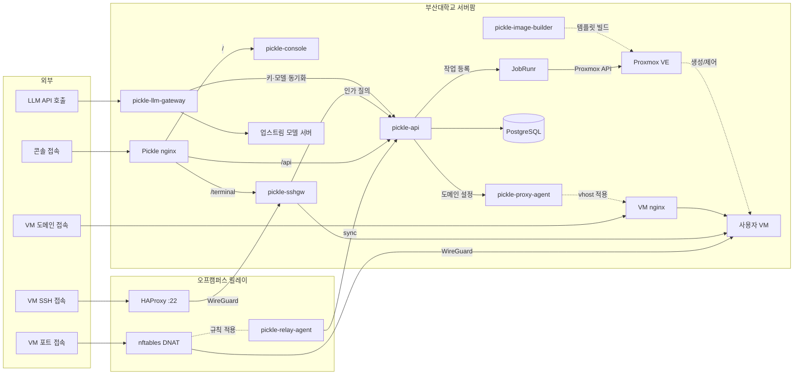

# pickle-llm-gateway

부산대학교 클라우드 플랫폼(Pickle)의 교내 LLM API 게이트웨이입니다. 학생 코드가 보내는
OpenAI 호환 요청을 받아 API Key를 검증하고 사용량 한도를 적용한 뒤, 업스트림 모델 서버로
전달합니다. 학생이 쓰는 주소는 `https://llm.pcl.kr/v1`이고, 발급받은 Key를 OpenAI SDK의
`base_url`과 `api_key`에 그대로 넣으면 됩니다.

## 요청 경로

```
학생 코드 (OpenAI SDK + API Key)
    │  POST /v1/chat/completions, POST /v1/completions, POST /v1/messages, POST /v1/responses, GET /v1/models
    │  POST /v1/images(/generations), GET /v1/images/models, POST /v1/embeddings, POST /v1/rerank
    │  POST /v1/audio/speech, POST /v1/audio/transcriptions
    ▼
llm-gateway ── 키 검증 · 한도 적용 · 모델명 변환 · 사용량 기록
    │
    ▼
업스트림 모델 서버 (OpenAI 호환 API)
```

학생 코드에는 공개 모델명만 보입니다. 실제 모델과 업스트림 주소는 게이트웨이 설정에만
있으므로, 업스트림을 교체해도 학생 코드는 바뀌지 않습니다.

아래 일곱은 패스스루 경로입니다. 요청 본문을 그대로 외부 공급자에게 전달하고 응답을 그대로
돌려줍니다. 전부 유료 모델이므로 비용은 그 Key에 부여된 금액 한도에서 나갑니다. Key마다
허용된 경로만 열리고 기본값은 전부 닫힘입니다.

| 경로 | 필요한 기능 |
|---|---|
| `POST /v1/images` | 이미지 생성 (`images`) |
| `POST /v1/images/generations` | 이미지 생성 (`images`) |
| `GET /v1/images/models` | 이미지 생성 (`images`) |
| `POST /v1/embeddings` | 임베딩 (`embeddings`) |
| `POST /v1/rerank` | 리랭크 (`rerank`) |
| `POST /v1/audio/speech` | TTS (`speech`) |
| `POST /v1/audio/transcriptions` | STT (`transcriptions`) |

`POST /v1/rerank`는 OpenAI나 Anthropic이 아니라 Cohere, Voyage 같은 API의 리랭크 호출입니다. 질의와 문서 목록을 받아
관련도 순서를 돌려줍니다. 사용량은 응답의 `usage`에서 읽되 업스트림 문서상 선택 필드이고, 모델에 따라 토큰 수
(`total_tokens`)와 금액이 오거나 토큰 없이 검색 단위(`search_units`)와 금액만 옵니다. 토큰이 없으면 0으로 기록하고 본문
크기로 추정하지 않습니다. 금액이 없으면 응답 본문의 `id`로 생성 기록을 조회해 채웁니다(이 경로는 `X-Generation-Id` 헤더가
없습니다). 응답의 `model`은 서빙 공급자의 원래 이름(예: `rerank-v3.5`)이라 요청한 이름과 비교하지 않고, 기록의 모델 이름은
요청한 이름입니다.

`POST /v1/audio/speech`는 OpenAI SDK의 `audio.speech.create()`가 부르는 음성 합성 경로입니다. 응답은 JSON이 아니라
음성 파일이고, 공급자의 미디어 타입(`audio/mpeg`, `audio/pcm;rate=24000;channels=1` 등)을 해석해 다시 적은 값으로
그대로 돌려줍니다. 오디오가 아닌 응답은 502 `upstream_error`입니다. 공급자는 mp3와 pcm만 만들고 `response_format`을 빼면
pcm(헤더 없는 원시 PCM)을 돌려주므로, `response_format`이 그 둘이 아니면 400으로 이유와 함께 거절합니다.
`stream_format`은 `audio`만 받고(공급자는 늘 파일 하나로 답합니다) 참조 음성으로 목소리를 만드는 `input_references`는
거절합니다. 응답에 사용량이 없으므로 토큰 0으로 기록하고 금액은 `X-Generation-Id`로 생성 기록을 조회해 채웁니다.

`POST /v1/audio/transcriptions`는 음성 인식 경로입니다. 공급자 형식의 JSON 본문(`input_audio`에 base64 `data`나
`url`)과, OpenAI SDK의 `audio.transcriptions.create()`가 보내는 multipart 업로드(`file` 파트)를 모두 받습니다.
multipart는 그대로 넘기지 않고 해석한 뒤 아는 필드(`model`, `language`, `prompt`, `response_format`, `temperature`,
`timestamp_granularities[]`, `keyterms[]`, `diarize`, `provider`, `source_url`, `stream`)와 파일 하나로 다시 조립해 보냅니다.
모르는 필드는 400 `unsupported_parameter`, 반복될 수 없는 필드가 반복되면 400 `invalid_parameter_value`입니다.
공급자는 `json`과 `verbose_json`만 돌려주므로 `response_format`이 그 둘이 아니면 400으로 이유와 함께 거절하고,
공급자가 받지 않는 `chunking_strategy`와 `include`도 거절합니다. 사용량은 시간 과금 모델이면 `seconds`와 `cost`만 와서
토큰 0과 금액으로, 토큰 과금 모델이면 `input_tokens`, `output_tokens`와 `cost`로 기록합니다. 금액이 없으면
`X-Generation-Id`로 생성 기록을 조회합니다.

`/v1/chat/completions`도 기능 권한 `chat`이 있는 Key에만 열립니다. 자체 서빙 모델과 유료 모델
모두에 적용되고, 채팅 없이 다른 기능만 쓰는 Key가 있기 때문에 기본으로 부여하지 않습니다.
`GET /v1/models`는 비용이 없으므로 기능 권한 없이 열립니다.

`GET /v1/models` 목록에는 자체 서빙 모델과 스냅샷 카탈로그 모델 뒤에, 그 Key로 실제로 부를 수 있는
유료 모델이 이름 순으로 붙습니다. 유료 모델은 게이트웨이가 패스스루 업스트림의 공개 카탈로그
`GET {BaseURL}/models?output_modalities=all`를 인증 없이 30분마다 읽어 둔 사본에서 가져옵니다. 읽기에
실패하면 1분부터 두 배씩 늘려 다시 읽고(최대 30분), 그동안은 마지막으로 읽은 사본을 그대로 씁니다.
한 번도 읽지 못했으면 목록에는 스냅샷 모델만 나옵니다. 스냅샷이 패스스루 업스트림을 바꾸면 옛
사본은 쓰지 않고 1분 안에 새 업스트림의 카탈로그를 읽습니다. 사본 상태는 관리 리스너 `/metrics`의
`vendorModelCatalog`에서 볼 수 있습니다(모델 수, 연속 실패 수, 사본이 있으면 경과 초).

유료 모델은 아래 조건을 모두 만족할 때 목록에 나옵니다.

- 단건 조회 `GET /v1/models/{id}`와 같은 판정을 통과한다. Key에 패스스루 업스트림 자격증명이 있고,
  모델 허용 목록과 금액 축 허용 목록, 차단 목록이 그 이름을 막지 않아야 합니다.
- 모델이 내는 출력 중 하나에 필요한 기능 권한이 Key에 있다. 텍스트는 `chat`, 이미지는 `images`,
  임베딩은 `embeddings`, rerank는 `rerank`, 음성 합성은 `speech`, 음성 인식은 `transcriptions`가
  필요합니다. 영상처럼 이 표에 없는 출력만 내는 모델은 나오지 않습니다.
- 라우터 이름(`openrouter/*`)과 `:free` 변형이 아니다.

항목은 표준 필드에 컨텍스트 길이만 더합니다. OpenAI 모양은 `context_length`, Anthropic 모양은
`max_input_tokens`와 `max_tokens`입니다. 카탈로그에 값이 없거나 0인 필드는 생략합니다. 가격, 모달리티, 지원
파라미터는 공급자 확장이라 싣지 않습니다. 자체 서빙 모델 항목은 표준 필드만 그대로 둡니다.

```json
{"id":"openai/gpt-4o-mini","object":"model","created":1721260800,"owned_by":"openai","context_length":128000}
```

단건 조회는 목록보다 넓습니다. 카탈로그에 없는 이름이나 위 기능 권한이 없는 모델도 판정을 통과하면
지금처럼 답합니다. 직접 호출은 어차피 공급자까지 가서 그쪽에서 판정되기 때문입니다. 카탈로그에 있는
이름이면 목록과 같은 항목으로 답합니다. 공급자 전용 조회 경로 `/v1/models/{author}/{slug}/endpoints`,
`/v1/embeddings/models`, `/v1/tools`는 지원하지 않으며 인증 전에 404 `unknown_endpoint`로 답합니다.
`/endpoints` 경로는 끝의 `/`와 대소문자가 달라도 같이 막습니다.

`POST /v1/responses`는 OpenAI Responses API 경로입니다. Codex와 OpenAI SDK의 `responses.create()`가
이 경로를 부릅니다. 기능 권한은 `/v1/chat/completions`와 같은 `chat`이고 **유료 모델만** 받습니다.
자체 서빙 모델 이름은 400 `model_not_available_on_route`로 거절합니다. 요청과 응답은 번역하지 않고
모델 이름만 바꿔 공급자의 `/responses`로 그대로 전달합니다.

- **응답을 저장하지 않습니다.** 공급자가 상태 없는 API만 제공하기 때문입니다. 저장이나 이전 응답
  참조가 필요한 요청(`store: true`, `previous_response_id`, `conversation`, `background: true`)은
  필드를 지우지 않고 400 `unsupported_parameter`로 이유와 함께 거절합니다. 지우고 보내면 저장된
  줄 알고 다음 요청에서 그 id를 쓰다가 엉뚱한 곳에서 실패합니다. 이전 대화는 `input`에 모두 담아
  보냅니다. `store: false`와 `null`은 통과합니다. Codex는 `store: false`를 보내므로 걸리지 않습니다.
- **하위 경로는 없습니다.** `/v1/responses/{id}`, `cancel`, `input_items`, `compact`는 저장된 응답을
  읽는 경로라 인증 전에 404 `unknown_endpoint`로 답하고 기록하지 않습니다.
- **필수 필드**는 `model`과 `input`이고, 출력 상한 필드는 `max_output_tokens`입니다.
- **펜스**는 Chat과 같은 자리(`models`, `tools`, `tool_choice`, `plugins`, `preset`, `:online`)에
  더해 `deferred_tools`와 `input` 항목 안의 `tools` 목록을 봅니다. 문자열도 목록도 아닌 `input`은
  판정할 수 없어 400 `invalid_parameter_value`로 거절합니다. Codex는 도구 목록을
  `additional_tools` 입력 항목에 실어 보내고, 클라이언트가 실행한 도구 검색은 찾은 도구를
  `tool_search_output` 항목으로 돌려주기 때문입니다. Codex가 기본으로 넣는 `web_search` 도구는
  `web_search` 권한이 없는 Key에서 403 `endpoint_not_allowed`입니다. Codex 설정에서
  `web_search = "disabled"`로 끄면 빠집니다.
- **요청 헤더**는 Chat과 같은 셋만 전달합니다. Codex가 붙이는 자기 세션과 턴 헤더는 전달하지
  않습니다. 응답에는 `X-Generation-Id`를 중계합니다.
- **스트림**은 `data:` 줄만 쓰고 이벤트 종류는 데이터의 `type`으로 구분합니다. 업스트림이 `event:`
  줄을 보내도 데이터의 `type`으로 읽습니다. 모델 이름은 응답 객체 안이든 이벤트 최상위든 있는
  자리에서 바꾸고, 모든 이벤트는 받은 바이트가 아니라 해석한 값을 다시 직렬화해 보냅니다. 객체
  뒤에 붙은 바이트나 이벤트 안의 줄바꿈이 클라이언트에 그대로 닿지 않게 하기 위해서입니다.
  `type` 없이 `error` 객체만 담긴 이벤트도 공급자 오류로 보고 끝냅니다. `response.completed`, `response.incomplete`,
  `response.failed`, `error` 가운데 하나가 오면 응답이 끝난 것으로 보고, 업스트림이 `[DONE]`을
  보냈든 안 보냈든 그 뒤에 `data: [DONE]` 하나를 붙입니다. 게이트웨이가 스트림 도중에 끊을 때는
  `{"type":"error","code":...,"message":...}` 이벤트 뒤에 `[DONE]`을 씁니다.
- **사용량**은 `response.completed`(비스트림은 응답 객체)의 `usage`에서 읽습니다. `input_tokens`는
  캐시 입력을 포함한 값이고 `input_tokens_details.cached_tokens`, `output_tokens_details.reasoning_tokens`,
  `cost`를 함께 기록합니다. `response.incomplete`(출력 상한에 걸려 끊긴 응답)는 사용량이 있으면
  정상 종료로 기록하고, `response.failed`와 스트림 안의 `error`는 업스트림 오류로 기록합니다.
  사용량이 없는 응답은 추정하지 않고 그대로 돌려준 뒤 `upstream_usage_missing`으로 기록합니다.
  본문 보관은 이 경로에서 하지 않습니다.

`POST /v1/completions`는 OpenAI의 레거시 텍스트 완성 경로입니다(OpenAI SDK의 `completions.create()`).
기능 권한은 `chat`이고 **유료 모델만** 받으며, 자체 서빙 모델 이름은 400 `model_not_available_on_route`로
거절합니다. 필수 필드는 `model`과 `prompt`이고, 출력 상한은 `max_tokens`와 `max_completion_tokens`를 읽어 작은 값을 `max_tokens`로 보냅니다. 요청과 응답은 모델 이름만
바꿔 공급자의 `/completions`로 전달하고, 펜스와 요청 헤더, 사용량(`usage`의 토큰과 `cost`, 스트림은 마지막
청크), 스트림의 `[DONE]` 처리는 Chat과 같습니다. 공급자는 사용량 청크에도 선택지(`choices`)를 실어 보내므로,
`stream_options.include_usage`를 요청하지 않은 클라이언트에는 그 청크를 `usage`만 빼고 전달합니다. 공급자가
`prompt`를 채팅 메시지로 바꿔 채팅 모델에 보내므로 원문을 그대로 이어 쓰는 동작은 보장되지 않고, 사고하는
모델은 출력이 `reasoning`으로 가고 `text`가 빌 수 있습니다. 사용량이 없는 응답은 추정하지 않고
`upstream_usage_missing`으로 기록하며 본문 보관은 하지 않습니다.

허용되지 않은 경로는 403 `endpoint_not_allowed`로 답합니다. 경로가 없는 것과 Key에 허용되지
않은 것은 다른 상태이므로 404로 감추지 않습니다. 거절 문구는 경로가 아니라 기능 이름으로
말하고 신청 방법을 함께 알려줍니다. 부여는 기능 단위이고, 학생이 승인자에게 요청할 때 쓰는
말이 승인 화면에 뜨는 말과 같아야 하기 때문입니다. 이 축은 학생이 스스로 우회할 수 없는
유일한 펜스이므로 거절만 알리고 끝내지 않습니다.

패스스루 요청은 본문에서 `model`과 `n`만 해석하고 나머지 필드는 값을 그대로 둔 채
전달합니다. `model`이 없으면 거절하고, `n`이 상한을 넘으면 업스트림에 보내기 전에 상한을
말하며 거절합니다. 응답이 중계 상한을 넘으면 `upstream_response_too_large`로 무엇을 줄여야
하는지 알려줍니다.

`POST /v1/images/generations`는 OpenAI SDK의 `images.generate()`가 보내는 경로입니다. 외부
공급자의 경로는 `/images`라서, 같은 경로를 SDK 이름으로도 받는 것입니다. 기능 권한, 모델
펜스, 사용량 기록, 상한은 `/v1/images`와 같고 본문과 응답도 그대로 전달합니다. 다만 공급자가
조용히 무시해 학생이 요청과 다른 결과를 받게 되는 OpenAI 필드는 이 경로에서 400
`unsupported_parameter`로 거절합니다.

- `response_format: "url"`: 공급자는 언제나 base64로 돌려주므로 `data[].url`이 비어 옵니다.
  `b64_json`은 통과합니다.
- `style`: 효과가 없습니다. 원하는 스타일은 `prompt`에 적습니다.
- `moderation`: 공급자는 OpenAI 모델에 한해 `provider.options.openai.moderation`으로만 받습니다.

`partial_images`는 스트림에서만 의미가 있고 이 경로는 스트림을 받지 않으므로 거절하지
않습니다.

정리하면 OpenAI SDK의 `images.generate()`는 `b64_json`으로만 동작하고 URL 응답은 지원하지
않습니다. SDK의 편집과 변형 경로(`/images/edits`, `/images/variations`)도 열지 않습니다. 참조
이미지로 편집하려면 이 경로의 `input_references`에 이미지를 담아 보냅니다.

JSON 객체는 같은 이름을 두 번 담을 수 있고 파서는 마지막 것을 씁니다. 그래서 전달하는
본문은 게이트웨이가 판정에 쓴 그 값으로 다시 직렬화한 것입니다. 판정한 이름과 업스트림이
받는 이름이 언제나 같은 문자열이 되도록 하기 위해서입니다.

## 주요 기능

이 게이트웨이가 맡는 부분은 아래와 같습니다.

- **API Key 검증**: 발급된 Key만 통과시키고, 폐기와 정지, 만료 상태를 반영합니다.
- **사용량 한도**: Key마다 분당 요청 횟수와 토큰 사용량, 동시 요청 수를 제한합니다.
  네 한도 모두 자체 서빙 모델에만 적용됩니다 — 유료 모델의 통제는 금액 한도입니다.
- **모델 이름 분리** — 요청과 응답의 모델명을 공개 이름으로 유지합니다.
- **기능 권한**: 채팅과 패스스루 경로는 Key마다 기능 단위로 엽니다. 부여된 기능이 없으면
  모델 목록 조회 말고는 한 경로도 열리지 않습니다. 채팅 안에서 요금이 따로 붙는 기능(웹 검색,
  유료 PDF OCR, 이미지 출력)은 요청 본문에서 판정해 그 기능의 권한을 따로 요구합니다.
- **사용량 계측**: 요청마다 토큰 사용량과 처리 결과를 기록합니다. 프롬프트와 응답 본문은
  기록하지 않습니다.
- **본문 보관(선택)**: Key마다 따로 켤 수 있고 기본은 꺼져 있습니다. 켠 Key의 요청·응답
  본문만 관리 API로 전달합니다.

## 동작 방식

인증 상태는 스냅샷 문서 한 개로 관리합니다. 어떤 Key가 있고 어떤 모델을 서빙하며 한도가
얼마인지가 JSON 문서 하나에 들어 있고, 게이트웨이는 이 문서를 통째로 읽어 원자적으로
교체합니다. 문서가 바뀌면 폴링 주기 안에 반영되므로, Key 폐기는 수 초 안에 적용됩니다.
세대 번호가 뒤로 가는 문서는 거부합니다. 폐기를 조용히 되돌릴 수 있기 때문입니다.
최고 세대 번호는 문서 옆 `snapshot.json.highwater` 파일에 남으므로, 재시작 뒤에 예전
문서가 되살아나도 거부합니다. 모델의 `upstreamRef`가 설정에 없는 업스트림을 가리키면
손으로 관리하는 파일에서는 그 문서의 적재를 거부하고, 관리 API가 준 문서에서는 그 모델
항목만 버립니다(아래). 어느 쪽이든 오타가 요청 시점이 아니라 적재 시점에 드러납니다.

`models`와 `keys` 항목 안의 모르는 필드는 어느 경우에도 무시합니다. 이후 관리 API가 항목에
필드를 하나 더해도 옛 게이트웨이가 문서를 통째로 버리지 않고 아는 만큼 계속 집행하기
위해서입니다. 문서 최상위는 **누가 썼는지에 따라** 다릅니다 — 손으로 관리하는 파일에서는
모르는 이름이 오타이므로 적재를 거부하고(`serviceEnable`이 조용히 무시되면 서비스가 켜진
채로 남습니다), 관리 API가 준 문서에서는 새 버전이 더한 항목일 수 있으므로 모르는 이름을
무시합니다. 그렇지 않으면 필요하지도 않은 필드 하나 때문에 폐기 반영이 멈춥니다. 모델의 `visibility`가 `RESTRICTED`이면
그 모델을 `allowedModels`에 명시한 키만 접근할 수 있고, 비어 있는 `allowedModels`는
`PUBLIC` 모델만 허용합니다. 새 모델을 넣어도 기존 키에 자동으로 열리지 않습니다.

모델에는 **예산 축**(`budgetAxis`)이 있습니다. `TOKEN`(기본값, 필드가 없으면 이 값)은
자체 서빙 모델의 축으로, **키 단위 한도 넷이 모두 이 축의 모델에만 적용됩니다** —
분당 요청 횟수와 분당 토큰 사용량, 동시 요청 수, 그리고 문서의 `quotaExhausted`
플래그(일일 토큰 한도)입니다. 넷 다 자체 서빙 용량을 나누는 장치이고, 유료 모델
호출은 그 용량을 쓰지 않습니다. 축은 요청 본문의 모델명으로만 알 수 있으므로
게이트웨이는 본문을 읽은 뒤에 이 한도들을 적용합니다. `CREDIT`은 유료 모델의 축으로, 요청에 **그 Key 전용 업스트림
자격증명**(`upstreamCredentials`의 해당 업스트림 항목)이 있어야 하고 금액 한도는 그
자격증명을 발급한 쪽이 강제합니다. CREDIT 축에서는 게이트웨이 공용 env 자격증명을
절대 대신 쓰지 않고, 자격증명이 없는 Key는 거절됩니다.
축은 모델 행의 속성이지 업스트림 종류가 아니므로, 같은 모델의 업스트림을 교체해도
축은 바뀌지 않습니다.

**요청 본문의 최상위 필드도 축이 정합니다.** 목록에 없는 이름은 무시가 아니라 거절
(`unsupported_parameter`, 400)입니다. 조용히 흘리면 업스트림을 교체할 때 학생 코드가 보낼 수
있는 것이 소리 없이 바뀝니다.

자체 서빙(TOKEN) 축이 받는 열일곱은 이렇습니다.

```
model  messages  stream  stream_options  max_tokens  max_completion_tokens
temperature  top_p  stop  presence_penalty  frequency_penalty  seed  user
response_format  tools  tool_choice  parallel_tool_calls
```

**자동 선택 모델은 지원하지 않습니다.** `openrouter/` 아래 이름은 **모델을 고르는 이름**이라 어떤
모델이 답할지 요청 시점에 정해지지 않고, 외부 공급자는 **고른 모델 기준으로 청구**합니다. 공급자
전용 기능이고 일반적인 LLM API에는 없으므로 **모든 Key에서 거절합니다.** 예전에는 모델 제한이 걸린
Key에서만 거절했습니다.

- 요청의 `model`에 적힌 라우터 이름은 400 `router_not_supported`로 거절합니다. Chat, Messages,
  Responses, 패스스루 경로가 같습니다. 단건 조회는 404로 답하고 목록에는 나오지 않습니다.
- 폴백 후보, 서버 도구, 플러그인에 적힌 라우터 이름은 그 필드의 거절(403 `model_not_allowed`)로
  막고, 문구에 필드 이름을 함께 적습니다.
- Key에 카탈로그 모델 목록(`allowedModels`)이 있으면 유료 모델 이름은 모두 그 목록에서 먼저 막히므로
  403 `model_not_allowed`가 됩니다.
- 거절 문구는 목록을 보라고 하지 않고 **일반적인 LLM API가 제공하는 모델 이름을 직접 지정하라**고
  알립니다.
- 자체 서빙(TOKEN) 카탈로그 항목은 이름이 같은 접두로 시작해도 라우터가 아니므로 이 규칙과 무관합니다.

이름 목록이 아니라 **벤더 접두사 전체**로 막습니다. 이름으로 적으면 공급자가 하나 추가할 때마다
새는데, 접두사로 막으면 자동으로 닫히기 때문입니다.

그 벤더 아래에 **진짜 모델이 있을 수 있습니다.** 활성 카탈로그(431개, 2026-09-05)에 보이는
여섯은 전부 선택기지만, 공개 기간이 끝나 목록에서 빠진 실제 모델이 둘 있습니다. 그래도 접두사로
막는 쪽이 맞습니다 — **잃을 것이 없어서가 아니라 잃는 대가가 싸기 때문입니다.** 그런 모델은
대개 무료 미리보기입니다.

`tools`가 부르는 모델도 같은 펜스를 지납니다. 공급자의 서버 도구 일부가 본문 안에서 다른 모델을
부르는데(`parameters.model`, Messages 경로에서는 도구 최상위의 `model`), 두 자리 모두 후보
목록과 같은 규칙으로 판정합니다. **이미지 생성
도구는 `images` 기능 권한도 함께 요구합니다** — 전용 경로로 부를 때는 필요하고 채팅으로 부를
때는 필요 없다면 그것은 권한이 아니기 때문입니다. 웹 검색 도구(`openrouter:web_search`)도 같은
이유로 `web_search` 기능 권한을 요구합니다. 중첩된 도구 목록 안에 있어도 같습니다.
`namespace` 도구가 묶은 도구(`tools`)와 `tool_choice`가 `type`으로 지정한 도구(`{"type":"web_search"}`,
`allowed_tools`의 `tools` 목록)도 같은 규칙으로 판정합니다. 도구를 정의하지 않고 `tool_choice`로만
불러도 같은 권한이 필요합니다.

**공급자 전용 서버 도구는 아는 것만 받습니다.** `openrouter:` 접두가 붙은 도구 가운데 이 게이트웨이가
아는 것(`web_search`, `image_generation`, `advisor`, `fusion`, `subagent`, `web_fetch`, `tool_search`,
`apply_patch`, `datetime`, `experimental__search_models`, `shell`, `bash`)만 위 규칙으로 판정하고,
나머지는 400 `unsupported_parameter`로 거절합니다. 이 서비스는 일반적인 LLM API가 제공하는 기능을
지원하고 공급자 전용 확장까지 맞추지는 않기 때문입니다. `openrouter:files`도 지금은 거절합니다.
접두가 없는 표준 도구(`function`, `custom`, `mcp`, `file_search`, `computer_use_preview` 등)는 그대로
통과합니다.

**샌드박스에서 명령이나 코드를 실행하는 서버 도구(`openrouter:shell`, `openrouter:bash`,
`local_shell`, `code_interpreter`)는 `containers` 기능 권한을 요구하고, 이 권한은 아직 부여하지 않습니다.** 그래서 지금은 어느 Key에서나 403
`endpoint_not_allowed`로 거절하고, 거절 문구는 신청 대신 도구를 빼고 다시 보내라고 안내합니다.
공급자의 컨테이너는 Key가 아니라 공급자 계정 단위로 묶이고, 어느 컨테이너를 쓸지는 요청에서
정해집니다. 호출자가 고른 id(`container_reference`)나 `session_id`, `X-Session-Id` 헤더,
`prompt_cache_key`에서 유도한 id입니다. 같은 계정 아래의 두 Key가 같은 id에 닿으면 서로의 파일을
읽고 쓸 수 있으므로, Key마다 컨테이너를 따로 쓰게 될 때까지 도구 쪽을 막아 둡니다. 세션 값과
`prompt_cache_key`는 그대로 전달합니다. 컨테이너가 없으면 프롬프트 캐시용 공급자 고정에만
쓰이기 때문입니다. 같은 도구가 지정한 모델도 거절 대상이면 이 거절이 먼저입니다. `local_shell`은
표준 API에서는 클라이언트가 실행하는 도구지만, 공급자는 자기가 직접 서빙하지 않는 모델에서 이 도구를
샌드박스로 보낸다고 문서화했습니다. `code_interpreter`는 호스팅 컨테이너에서 코드를 실행합니다.

**공급자는 서버 도구 하나를 여러 `type` 철자로 받습니다.** `openrouter:web_search` 말고도
`web_search`, `web_search_preview`, `web_search_preview_2025_03_11`, `web_search_2025_08_26`가
Chat에서 같은 유료 검색을 실행하고, Messages에서는 `web_search_20250305` 같은 Anthropic 철자와
`advisor_20260301`, `image_generation`이 그렇습니다. 그래서 `type`에서 `openrouter:` 접두와 날짜
접미사(`_20250305`, `_2025_03_11`)를 뗀 기본 이름으로 어떤 도구인지 정한 뒤 판정합니다. 기본
이름이 `web_search`, `image_generation`, `advisor` 등으로 시작하면 그 도구로 봅니다.
`web_fetch`는 권한 없이 통과하고, `code_execution_*`는 공급자가 400으로 거절하므로 그대로
보냅니다. `shell`, `shell_<날짜>`는 `openrouter:shell`로, 날짜 없는 `bash`는 `openrouter:bash`로
봅니다. `bash_20250124` 같은 날짜 붙은 `bash`는 공급자 문서가 명령을 애플리케이션에 돌려주는
클라이언트 도구로 설명하므로 서버 도구로 보지 않고 통과시킵니다. `apply_patch`는 패치를
애플리케이션이 적용하는 도구라 컨테이너를 쓰지 않으므로 권한 없이 통과합니다.

모델 제한이 걸린 Key에서는 **모델을 비워 둔 서버 도구도 거절합니다.** `openrouter:advisor`(와
`advisor_20260301`)는 `model`이 도구 최상위에도 `parameters`에도 없으면 답을 만드는 모델이 생성 도중에 자문 모델을 고르고,
`openrouter:fusion`은 `model`과 `analysis_models`가 없으면 공급자 기본값을 씁니다. 어느 쪽도
요청에 이름이 드러나지 않아 판정할 수 없습니다. `openrouter:subagent`는 모델이 없으면 요청의
`model`을 쓰므로 그대로 통과합니다. 도구가 안쪽 호출용으로 다시 받는 `parameters.tools`도 같은
규칙으로 판정합니다.

**`plugins`도 펜스를 지납니다.** `fusion` 플러그인의 `model`과 `analysis_models`는 같은 규칙으로
판정하고, 공급자 쪽에서 모델 묶음으로 펼쳐지는 `preset`은 모델 제한이 걸린 Key에서 거절합니다.
라우터 플러그인(`auto-router`, `auto-beta-router`, `pareto-router`, `jev-router`,
`switchyard-router`)은 모델 제한이 걸린 Key에서 거절합니다. 후보가 와일드카드나 점수라 판정할 수
없기 때문입니다. 그 설정을 읽는 라우터 모델(`openrouter/*`)은 이제 어느 Key에서도 쓸 수 없어서,
제한이 없는 Key가 보낸 라우터 플러그인은 설정할 대상이 없습니다.
`context-compression`은 모델 이름을 받지 않고 작은 컨텍스트 모델에서는 지정하지 않아도 켜지므로
판정 대상에 넣지 않았습니다.

**`preset`도 거절합니다.** preset은 모델과 폴백 목록을 통째로 담을 수 있어 펜스가 읽는 필드
바깥에서 판정을 지나갑니다. 최상위 `preset` 필드, `@preset/slug` 모델명, `모델@preset/slug`
형태 셋 다 막습니다. **제한이 없는 Key에서도 막습니다** — preset은 플랫폼 계정에 저장되고 모든
학생 Key가 그 계정 아래 발급되므로, 하나 생기면 전부가 닿기 때문입니다. 카탈로그 431개에 `@`가
든 id가 없어 잃는 기능이 없습니다.

**차단 목록은 `~`를 제거한 이름도 검사합니다.** `anthropic/*`를 차단하면
`~anthropic/claude-sonnet-latest`도 차단됩니다. 허용 목록에서 공급자를 직접 지정할 때는
`anthropic/*`와 `~anthropic/*`를 구분합니다. 공급자 자리 전체를 `*`로 지정하면 두 이름을
모두 포함합니다.

**공급자 접두 없는 `claude-` 이름은 `anthropic/`을 붙인 이름으로도 판정합니다.** 공급자가
Messages 경로에서 `claude-opus-5-5`(없는 날짜를 붙인 이름까지)를 `anthropic/claude-opus-5.5`로
해석해 그 모델 값으로 청구하기 때문입니다. 요청의 이름은 바꾸지 않고 판정만 두 이름으로 합니다.
허용 목록은 둘 중 하나라도 맞으면 허용, 차단 목록은 둘 중 하나라도 맞으면 차단이고 차단이
우선합니다. 그래서 `anthropic/*` 차단은 `claude-opus-5-5`도 막고, `anthropic/claude-opus*` 허용은
그 이름을 엽니다. 다른 접두 없는 이름은 적힌 그대로만 판정합니다.

**`models`는 예외입니다.** 목록에 적힌 이름은 외부 공급자가 `model` 대신 서빙하고 **그
이름으로 청구**할 수 있습니다(공급자 문서: 어떤 오류든 폴백을 촉발할 수 있고, 요청 가격은
최종적으로 쓰인 모델로 매겨집니다). 그래서 목록의 **모든 항목에 모델 펜스를 적용**하고,
하나라도 걸리면 그 이름을 말하며 거절합니다. 막는 것이 아니라 판정하는 것이라서, 키가 이미
쓸 수 있는 모델들 사이의 폴백은 그대로 됩니다. 항목은 예약 접두 가드도 지나야 합니다 —
`pickle-` 이름이 폴백으로 새어 나가면 안 되기 때문입니다.

`model` 없이 `models`만 보내도 됩니다. 공급자 문서가 정한 모양으로, 첫 항목이 주 모델입니다.
게이트웨이는 첫 항목을 `model`과 똑같이 판정하고(이름 규칙, 예산 축, 모델 펜스, 자격증명),
목록 전체에도 위의 펜스를 그대로 적용합니다. 업스트림에는 학생이 보낸 모양 그대로
`model` 없이 목록만 보내고, 첫 항목만 실제 업스트림 모델 이름으로 바꿉니다.

**유료(CREDIT) 축에는 그 밖의 허용 목록이 없습니다.** 최상위 필드는 그대로 외부 공급자에게
갑니다. 공급자가 정의하는 필드이고 학생 자신의 금액 한도로 지불하는 요청이라, 여기서 거르던
것은 통제가 아니라 우리 편의였습니다. `reasoning_effort`와 `verbosity`는 물론이고 공급자가
실제로 쓰는 `reasoning` 객체, 라우팅과 플러그인과 캐싱 제어, 그리고 공급자가 나중에 추가하는
필드까지 게이트웨이를 고치지 않고 쓸 수 있습니다. 에이전트 도구는 모델 정보를 보고 이런
필드를 스스로 붙이므로, 막아 두면 추론 가능한 유료 모델이 이 게이트웨이로는 못 쓰게 되고
호출자가 할 수 있는 일이 없습니다.

**요청 헤더는 유료 모델의 채팅 요청에서 셋만 전달합니다.** `x-anthropic-beta`(Anthropic 베타 기능,
예: strict 도구 사용), `x-session-id`(프롬프트 캐싱을 위한 공급자 고정), `X-OpenRouter-Metadata`(응답
본문에 이 요청의 공급자 선택과 폴백 과정을 싣는 옵션)입니다. 마지막 것은 조직 가드레일 판정도 함께
실으므로, 조직이 가드레일을 쓰기 시작하면 다시 판단해야 합니다. 값이 1 KiB를 넘으면
버립니다. 자체 서빙 모델에는 어떤 헤더도 전달하지 않습니다. 일부러 전달하지 않는 것은 둘입니다.

- 앱 귀속 헤더(`HTTP-Referer`, `X-OpenRouter-Title`, `X-Title`, `X-OpenRouter-Categories`): 공급자가 귀속된
  트래픽을 공개 순위와 앱 페이지에 싣고, 앱을 계정이 아니라 URL로 묶습니다. 전달하면 학생 한 명이
  플랫폼 계정의 트래픽을 아무 URL 아래에, 남의 앱 아래에도 공개할 수 있습니다.
- 응답 캐싱(`X-OpenRouter-Cache`, `-Cache-TTL`, `-Cache-Clear`): 캐시 적중은 토큰 0, 금액 0의 정상
  응답처럼 보이고 응답 헤더로만 구별됩니다. 사용량 기록이 적중을 표시하기 전까지는 열지 않습니다.

**응답 헤더는 둘만 돌려줍니다.** 유료 모델의 성공 응답에는 공급자의 생성 id(`X-Generation-Id`)를,
공급자가 429나 503으로 답할 때는 게이트웨이의 오류 응답(429는 503 `server_busy`, 503은 502
`upstream_error`)에 공급자가 정한 대기 시간(`Retry-After`, 1시간 이하의 초)을 실어 보냅니다. 폴백
업스트림까지 시도했으면 가장 긴 대기 시간입니다. 이미지와 임베딩 경로도 같습니다. 계정 전체의 한도를 말하는 `X-RateLimit-*`, 계정 예산이 찼을
때의 402에 붙는 `Retry-After`, 캐시 헤더는 돌려주지 않습니다.

**TOKEN 축에서는 그 둘이 계속 거절됩니다.** `chat_template_kwargs`와
`thinking_token_budget`도 마찬가지입니다. 서빙 프로세스가 그 필드에 실패하기 때문이 아닙니다.
실측하면 `reasoning_effort`를 받아들이고 사고를 켜서 답을 `content`에서 `reasoning`으로
옮깁니다. **자체 서빙의 사고를 요청 단위로 열지 않는다는 것이 운영 결정이고, 이 목록이 그
결정의 집행 지점입니다.** 사고를 켜면 완성 토큰이 자릿수 단위로 늘고 그 비용은 공용 토큰
한도가 받습니다. 또 폴백이 유료 모델 업스트림을 가리키는 순간 그쪽은 그 필드를 존중하므로,
자체 서빙 한도에 추론 토큰이 실립니다.

**축은 모델의 속성이므로 검사도 모델을 읽은 뒤에 돕니다.** 요청 모양 오류가 권한 오류보다
먼저 오도록, 허용 목록 검사는 축을 안 직후이자 Key의 모델 접근 검사 직전입니다. TOKEN 축에
유료 모델 전용 필드를 보내면 공개 코드는 같은 `unsupported_parameter`이고 안내 문구만 다릅니다.
코드를 하나 더 만들면 모든 SDK가 이미 다루는 사실을 위해 새 이름을 하나 더 배워야 합니다.

자격증명이 없는 이유는 두 가지이고 거절도 둘로 나뉩니다. 금액 한도를 받은 적이 없으면
`credit_unavailable`(403)이고, 한도는 부여됐는데 그 Key의 업스트림 자격증명이 아직
만들어지지 않았으면 `credit_pending`(503)입니다. 뒤쪽은 관리 API가 문서에
`creditPending`으로 표시해 주는 상태이고 저절로 끝나므로, 응답에 `Retry-After`가
실립니다. 단 `/v1/messages`에서는 오류 종류를 `overloaded_error`가 아닌 `api_error`로 하고
`x-should-retry: false`를 붙입니다. Anthropic SDK와 Claude Code는 이 헤더를 보면 스스로
재시도하지 않지만, Claude Code는 `overloaded_error`면 헤더와 상관없이 재시도합니다. 그대로 두면
상태가 몇 분 이어지는 동안 학생 화면이 멈춥니다. 앞쪽은 사람이 한도를 신청해야 풀리므로 헤더가 없습니다. 문서에
`creditPending`이 없는 관리 API를 쓰면 두 경우 모두 `credit_unavailable`이 됩니다.

문서 최상위의 `passthroughRef`가 설정돼 있으면, 카탈로그에 없는 모델명은 그 업스트림으로
**이름 그대로** 전달됩니다(패스스루). 패스스루 모델은 항상 CREDIT 축으로 취급되므로 Key
자격증명이 없으면 거절되고, `pickle-` 접두 이름은 대소문자와 무관하게 패스스루되지 않습니다.
자체 서빙 모델명의 오타가 과금 요청이 되지 않도록 404로 남기기 위해서입니다. 공개 모델명은
소문자로 쓰고 조회는 대소문자를 구분하며, `pickle-` 접두는 자체 서빙 모델 전용입니다.
과거에 같은 용도로 쓰던 `pnu-` 접두도 예약이 유지되어 패스스루되지 않습니다. API Key
평문도 같은 `pickle-` 접두를 쓰지만 전달 위치가 다릅니다 — Key는 Authorization 헤더,
모델명은 요청 본문의 `model` 필드로만 해석되므로 접두가 같아도 서로 혼동되지 않습니다.
Key별 자격증명 발급과 갱신은 관리 API 모드의 몫입니다. 손으로 관리하는 파일 모드는 토큰
축 운영을 전제하며, `passthroughRef`를 파일에 쓸 때는 해당 업스트림 env 블록을 먼저
설정해야 합니다(없으면 문서 적재가 거부됩니다).

Key에는 CREDIT 축 전용 허용 목록 `creditAllowedModels`가 있습니다. **비어 있으면 제한이
없고**(금액 한도만이 경계), 비어 있지 않으면 CREDIT 축 모델은 목록에 맞는 이름만 쓸 수
있습니다. 모델 자리는 정확한 이름, 전체를 여는 `*`, 접두를 여는 `gpt-5-*`,
접미를 여는 `*-pro`를 받습니다. 모델 자리의 별은 한쪽 끝에 하나만 사용합니다.
공급자 자리는 정확한 이름 또는 전체를 뜻하는 `*`를 받습니다.
`openai/*`, `*/gpt-5`, `*/gpt-5-*`, `*/*-pro`, `*/*`를 사용할 수 있으며,
`open*/*`와 `~*/*`는 거부합니다.
별은 빈 문자열도 먹으므로 `openai/gpt-5*`는 `openai/gpt-5` 자체를 포함하고,
`openai/gpt-5-*`처럼 구분자로 끝나는 접두도 그 계열의 이름인 `openai/gpt-5`를
포함합니다. 정확한 이름과 접미를 여는 항목은 `:batch`나 `:free` 같은 변형 접미사를 제거한
이름으로도 비교하므로 `openai/gpt-5-pro`와 `*/*-pro`는 모두
`openai/gpt-5-pro:batch`에 맞습니다. 접미 항목이 접미사만 남은 이름(`openai/pro`)까지 잡지는
않습니다. 판정은 소문자로 내려 비교하므로 대소문자가 다른 이름으로 목록을 우회할 수
없습니다(위의 `allowedModels`는 대소문자를 구분합니다. 그쪽은 카탈로그 이름의 정확
일치라서 그렇고, 두 목록이 함께 채워지면 더 엄격한 쪽이 답을 정합니다). `*` 하나만 적는
것은 허용하지 않습니다. 빈 허용 목록은 이름에 제한을 두지 않습니다. `*/*`는 공급자가
있는 이름만 포함합니다. 라우터 모델은 목록과 관계없이 모든 Key에서 거절합니다.

벤더가 내놓는 부동 별칭(`~anthropic/claude-sonnet-latest` 처럼 그 계열의 최신 모델로 항상
따라가는 이름)도 목록에 적을 수 있습니다. 이 이름들은 passthrough 로 그대로 나가므로,
목록이 이들을 적지 못하면 제한이 걸린 Key 가 제한이 없는 Key 보다 좁아지는 자리가
생깁니다. **허용 목록의 `~anthropic/*`와 `anthropic/*`는 서로를 포함하지 않습니다.**
공급자 자리 전체의 `*`는 별칭도 포함하므로 `*/*-pro`는 `~openai/gpt-5-pro`에 맞습니다.
판정은 이름으로만 하며, 별칭이 실제로 가리키는 모델을 조회하지 않습니다.

차단 목록 `creditDeniedModels`는 허용 목록이 열어 둔 것에서 모델을 다시 빼냅니다. 항목의
문법은 허용 목록과 같고 `~`를 제거한 이름도 검사합니다. **차단이 허용을 이깁니다.**
비어 있으면 아무것도 차단하지 않으므로, 두 목록이 다 비어 있는 Key는 금액 한도만이
경계입니다. 허용 목록을 벤더 단위로
넓게 쓰고 값이 튀는 이름 몇 개를 차단 목록으로 빼는 것이 이 조합의 쓰임새입니다.
차단으로 막힌 호출은 허용 목록에 없어서 막힌 호출과 **같은 응답**을 받습니다(403
`model_not_allowed`). 어느 목록 때문인지는 알려주지 않습니다. 승인자가 아닌 호출자에게
목록의 내용을 한 이름씩 알려주는 셈이고, 호출자가 할 일은 두 경우 모두 같기 때문입니다.

**두 목록 다 TOKEN 축을 건드리지 않습니다.** 목록이 걸린 Key도 자체 서빙 모델은 그대로
씁니다. 목록은 돈에 대한 울타리이고 자체 서빙에는 두를 돈이 없기 때문입니다. 위의
`allowedModels`와 역할이 다릅니다. 그쪽은 카탈로그 모델을 큐레이트하는 축이라, 채우면
자체 서빙 모델까지 함께 잠깁니다.

적재할 수 없는 항목이 하나라도 있으면 **그 Key를 통째로 버립니다.** 허용 목록도 차단
목록도 그렇습니다. 결론은 같지만 근거는 반대입니다. 허용 목록은 항목만 빼면 목록이 비어
제한 없음이 되고, 차단 목록은 항목만 빼면 막고 있던 모델이 도로 열립니다.

Key의 `passthroughEndpoints`는 그 Key의 **기능 권한**입니다. 값은 기능 이름이고 이 게이트웨이가
판정하는 어휘는 아래와 같습니다. 경로가 아니라 기능을 적으므로 벤더가 같은 기능 아래에 하위
경로를 더해도 목록은 그대로 둡니다. 모르는 이름은 그대로 두고 아무것도 열지 않습니다.

| 기능 | 여는 것 |
|---|---|
| `chat` | `POST /v1/chat/completions`(자체 서빙과 유료 모델 모두), `POST /v1/messages`, `POST /v1/responses`, `POST /v1/completions`(이 셋은 유료 모델만) |
| `web_search` | 유료 모델 채팅의 웹 검색. `plugins`의 `{"id":"web"}`, 모델 이름이나 `models` 후보, 서버 도구와 fusion 플러그인이 지정한 모델의 `:online` 접미사, `openrouter:web_search` 도구와 그 다른 철자(`web_search`, `web_search_preview`, `web_search_20250305` 등), OpenAI 표준 `web_search_options` |
| `pdf_ocr` | 유료 모델 채팅의 유료 PDF OCR. `file-parser` 플러그인이 `pdf.engine`으로 `mistral-ocr`를 지정한 요청 |
| `images` | `POST /v1/images`, `POST /v1/images/generations`, `GET /v1/images/models`, 그리고 유료 모델 채팅의 이미지 출력(`modalities`에 `image`, `openrouter:image_generation` 도구와 `image_generation`) |
| `embeddings` | `POST /v1/embeddings` |
| `rerank` | `POST /v1/rerank` |
| `transcriptions` | `POST /v1/audio/transcriptions` |
| `speech` | `POST /v1/audio/speech`, 그리고 유료 모델 채팅의 음성 출력(`modalities`에 `audio`). 음성 입력은 판정하지 않습니다 |
| `containers` | 유료 모델 채팅의 샌드박스 명령과 코드 실행. `openrouter:shell` 도구와 그 다른 철자(`shell`, `shell_<날짜>`, `local_shell`), `openrouter:bash` 도구와 날짜 없는 `bash`, `code_interpreter`. **아직 부여하지 않습니다** |

채팅 안의 기능은 **그 기능만을 뜻하는 필드로만** 판정합니다. 그 기능을 쓸 수도 있었던 요청은
거절하지 않고, 거절할 때는 요청을 고쳐 넘기지 않고 403으로 답합니다. 그래서 판정하지 않는 것이
있습니다. 모델 스스로 검색하는 모델, 엔진을 지정하지 않은 PDF를
PDF를 직접 읽지 못하는 모델에 보낸 요청(공급자가 유료 엔진을 기본으로 씁니다)입니다. 판정할 수
없는 값(`modalities`가 목록이 아니거나 `pdf.engine`이 문자열이 아닌 경우)은 400으로 거절합니다.
모델 거절과 기능 거절이 겹치면 모델 거절이 먼저입니다.

**비어 있으면 한 경로도 열리지 않습니다.** 위의 두 모델 목록과 기본값이 반대이고 의도한
것입니다. 모델 목록은 이미 있는 표면을 좁히지만 이 목록은 표면 자체이고, 아무도 부여하지
않은 경로가 게이트웨이의 버전이 올라갔다는 이유만으로 열려서는 안 되기 때문입니다. 필드가
아예 없는 문서도 같은 뜻으로 읽히므로, 이 필드를 보내지 않는 관리 API와 짝지어도 열리는
경로가 없습니다.

**`chat`도 이 목록에 있으므로, 이 필드를 모르는 관리 API의 문서로는 모든 Key의 채팅이
막힙니다.** 관리 API가 모든 기존 Key에 `chat`을 부여한 뒤에 이 게이트웨이를 배포하고, 되돌릴
때는 게이트웨이를 먼저 되돌립니다. 관리 리스너의 `/metrics`에 있는 `activeKeysWithoutChat`이
지금 적용된 문서에서 `chat`이 없는 사용 가능한 Key 수입니다. 배포 직후와 재시작 뒤에 이 값이
활성 Key 전체와 같으면 `chat`을 모르는 문서가 적용된 것입니다. 이 값으로 집행을 끄지는
않습니다. 그리고 이 필드로는 Key를 버리지 않습니다. 읽을 수 없는
항목은 기능 하나를 빼는 방향이라 안전한 쪽으로 기울기 때문입니다.

각 응답은 `X-Request-Id` 헤더로 그 요청의 기록 식별자를 돌려주므로 문의에 인용할 수
있습니다. `/healthz`는 세대·스냅샷 나이·리로드 정체 여부를 함께 반환합니다.

문서는 두 곳에서 올 수 있습니다. 기본값은 운영자가 관리하는 **로컬 파일**이고,
`LLMGW_SNAPSHOT_SOURCE=http`로 두면 **관리 API에서 받아옵니다**. 관리 API 모드에서는 **적재에 성공한**
문서만 로컬에 캐시하므로, 관리 API가 닿지 않는 동안 재시작해도 마지막으로 실제 적용했던
상태로 기동합니다. 문서 형식은 두 경우가 같습니다.

거부된 문서는 계속 다시 제시되므로 `/healthz`의 실패 횟수가 계속 올라갑니다 — 스냅샷
기록이 깨진 상태가 조용히 정상으로 보이지 않습니다.

**문서 하나가 통째로 거부되면 그동안 폐기와 정지가 반영되지 않습니다.** 그래서 관리 API가
준 문서에서는 게이트웨이가 다룰 수 없는 값(모르는 상태 이름, 이 호스트에 설정되지 않은
업스트림)을 만나도 그 항목만 버리고 나머지를 적용하며, 버린 개수를 `/healthz`와 지표에
드러냅니다. 키 한 개가 사라지면 그 키가 막히고(안전한 쪽), 모델 한 개가 사라지면 그 모델만
없어지지만, 문서 전체가 얼어붙으면 폐기한 키가 계속 동작합니다. 반면 손으로 관리하는
파일에서는 같은 상황이 방금 한 편집의 오류이므로 적재를 실패시킵니다. 파싱 자체가 안 되는
문서, `serviceEnabled`가 빠진 문서, `models`와 `keys` 중 한쪽이라도 빠진 문서는 어느
쪽에서도 거부합니다 — 각각 서비스 전체 점검 모드와 전 키 무효를 뜻하게 되기 때문입니다.
둘 다 빠진 문서도 마찬가지입니다. 관리 API에서는 그 형태가 "변경 없음"을 뜻하지만 전송
계층이 걸러내므로 여기까지 오지 않고, 파일에서는 잘렸거나 쓰다 만 문서일 수밖에 없습니다.

요청 처리는 이렇게 흐릅니다. Authorization 헤더의 Key를 sha256으로 해시해 스냅샷에서
찾고, 한도를 확인한 뒤 요청 본문의 모델명을 실제 모델로 바꿔 업스트림에 전달합니다.
스트리밍 응답은 조각 단위로 그대로 흘려보내면서 모델명만 공개 이름으로 되돌립니다.
자체 서빙 모델에서 지원하지 않는 파라미터는 이름을 밝혀 거부하므로, 업스트림을 바꿔도
학생 코드가 보내는 요청의 의미는 달라지지 않습니다.

**보낼 수 있는 파라미터는 모델의 예산 축이 정하고, 두 축은 대칭이 아닙니다.**

**자체 서빙 모델에는 허용 목록이 있습니다.** 목록에 없는 최상위 필드는 이름을 밝혀
거부합니다. 이 목록이 「자체 서빙은 사고 모드 기본 off, 요청마다 켜는 수단 없음」을 집행하는
유일한 자리입니다. `reasoning_effort`와 `verbosity`도 여기서 거부하되, **유료 모델에서는
쓸 수 있다는 것을 문구로 알립니다.** 필드가 틀린 것이 아니라 축이 틀린 것이므로, 학생이
다음에 무엇을 할지 알 수 있는 단서는 그 문구뿐입니다.

**유료 모델에는 허용 목록이 없습니다.** 최상위 필드는 그대로 업스트림으로 갑니다. 제공자가
정의하는 필드이고 학생 자신의 금액 한도로 지불하는 요청이라, 여기서 거르던 것은 통제가
아니라 우리 편의였습니다. 외부 공급자가 받는 요청을 이 게이트웨이가 대신 거절할 이유가 없습니다.
외부 공급자가 나중에 추가하는 필드도 게이트웨이를 고치지 않고 쓸 수 있습니다.

허용 목록과 별개로 도는 것 넷은 축과 무관하게 그대로입니다. 모델명 치환, 스트리밍의
`stream_options.include_usage` 강제, 출력 상한 주입, `pickle-` 예약 접두 가드입니다.

어느 축인지는 요청 본문의 모델명이 정하므로, 이 판정은 본문을 읽고 모델을 찾은 뒤에 합니다.

토큰 사용량은 업스트림이 돌려주는 usage 값으로 기록합니다. 스트리밍 요청은 업스트림에
`stream_options.include_usage`를 강제로 켜서 마지막 조각의 사용량을 받되, 학생이 직접
요청하지 않았다면 그 조각은 계측에만 쓰고 응답으로는 보내지 않습니다. 사용량을 얻지
못한 채 끝난 요청은 크기 기반 추정치를 `estimated` 표시와 함께 기록합니다. 기록은 하루 단위
JSONL 파일에 쌓입니다. 모델을 정상적으로 결정한 요청은 그 시점의 예산 축(`TOKEN` 또는
`CREDIT`)도 함께 기록하며, 모델을 결정하지 못한 요청에는 이 필드가 없습니다. 이 파일은
**발송 대기함**이기도 합니다 — 전송을 켜면 마지막으로
보낸 지점부터 이어서 관리 API로 배치 전송하고, 실패하면 물러섰다 다시 시도합니다. 항목마다
고유한 `eventUuid`가 있어 같은 항목이 두 번 도착해도 중복으로 쌓이지 않습니다.

HTTP 200으로 시작한 스트림에서도 최상위의 null이 아닌 `error`나
`choices[].finish_reason: "error"`를 받으면 사용량 결과를 `UPSTREAM_ERROR`, 오류 유형을
`upstream_error`로 기록합니다. 오류 조각은 클라이언트에 전달하며, 이미 사용한 토큰과 금액도
기록합니다.

항목은 회계에 필요한 것만 담고 프롬프트나 응답 본문은 어떤 필드에도 담지 않습니다. 토큰 수
외에 함께 적히는 것은 요청이 들어온 경로(`endpoint`), 업스트림이 응답한 모델 이름
(`servedModelName`), 업스트림이 보고한 요청 하나의 금액(`costUsd`), 돌아온 이미지 수
(`imageCount`), 캐시에서 나온 입력 토큰과 사고에 쓰인 출력 토큰(`cachedInputTokens`,
`reasoningTokens`), 스트리밍 여부(`streamed`)입니다.

정상으로 끝난 스트림은 Chat, Completions, Messages, Responses 모두 마지막 usage에 금액이 옵니다. 유료 모델 스트림이 금액
없이 끝나면(클라이언트 연결 끊김, 이벤트 상한 초과, 업스트림 끊김 등) 게이트웨이가 응답을 닫은 뒤
업스트림의 생성 기록(`GET /generation?id=<X-Generation-Id>`)을 그 Key의 자격증명으로 조회해
`total_cost`를 `costUsd`에 채우고 나서 항목을 씁니다. 토큰 수는 덮어쓰지 않습니다. 기록은
스트림이 끝나고 11~12초 동안 404라(2026-10-14 실측) 12초 뒤에 처음 읽고, 404면 18, 28, 43,
58초에 다시 읽습니다. 실패한 요청의 기록은 계속 404이므로 60초가 지나면 금액 없이 씁니다. 조회
한 번은 5초에서 끊습니다. 그래서 이런 항목은 보통 12초쯤, 최대 60초 늦게 쌓이고, `latencyMs`에는
이 대기가 들어가지 않습니다. 대기 중인 조회는 512개까지이고, 넘으면 그 항목은 금액 없이 바로
씁니다. 종료 신호를 받으면 남은 조회를 종료 유예(리스너 종료와 합쳐 60초) 안에서 기다리고, 유예가
끝나면 금액 없이 씁니다. 조회 한도와 유예가 같은 60초라 종료 직전에 끝난 스트림은 대개 금액 없이
기록되며, 이것이 정상 동작입니다. 관리 리스너의 `/metrics`에서 `streamCostFilled`는 조회로 금액을
채운 수, `streamCostMissing`은 못 채운 수입니다.

패스스루 경로는 업스트림이 200으로 답해 이미 과금한 뒤 게이트웨이가 응답을 넘기지 못한 요청(응답 상한을 넘어
`upstream_response_too_large`로 거절, JSON이 아니라 `upstream_invalid_response`로 거절, 응답을 읽다 끊김, 클라이언트에게
쓰다 끊김)이 금액 없이 끝나면, 응답을 닫은 뒤 그 응답의 `X-Generation-Id`로 생성 기록을 조회해 `costUsd`를 채웁니다.
이미지와 임베딩처럼 매 호출에 usage를 보고하는 경로의 성공 응답은 금액이 없어도 조회하지 않습니다(호출마다 업스트림
조회가 하나씩 붙기 때문입니다). usage가 선택인 경로는 금액 없는 응답을 모두 조회합니다. 비채팅 호출의 생성 기록은 더 늦게
나와서(2026-10-21 실측, 음성 합성과 rerank 모두 15초까지 404, 25초에 200) 15초 뒤에 처음 읽고 25, 35, 50, 70, 100초에 다시
읽으며 2분이 지나면 금액 없이 씁니다. 대기 자리는 스트림과 따로 256개이고, 넘치면 그 항목은 금액 없이 바로 씁니다. 종료
유예(60초)보다 기한이 길어서 종료 직전의 조회는 금액 없이 기록됩니다. 큰 본문 슬롯은 조회를 기다리지 않고 응답이 끝나면
바로 돌려줍니다. 카탈로그 조회(`GET /v1/images/models`)는 과금되지 않으므로 조회하지 않습니다. 지표는
`passthroughCostFilled`, `passthroughCostMissing`으로 따로 셉니다.

패스스루 응답의 usage에 토큰 수 없이 금액만 오면(초나 검색 단위로 과금되는 호출) 토큰 0과 그 금액을
`estimated` 없이 기록합니다. 본문 크기로 토큰을 지어내지 않습니다. 금액 0도 업스트림의 값으로 그대로 기록하고 조회하지
않습니다(아주 짧은 rerank와 캐시 적중은 실제로 0입니다). 토큰도 금액도 없으면 이미지와 임베딩처럼 usage가 필수인 경로는 크기 기반 추정으로 가고, rerank처럼 usage가 선택인 경로는 토큰 0으로 기록합니다.

세 가지는 읽는 쪽이 알아야 합니다. **`costUsd`가 없는 것은 0이 아닙니다** — 업스트림이 가격을
보고하지 않았다는 뜻이고, 무료 모델이 진짜로 0을 보고하는 것과 다릅니다. **캐시와 사고 토큰은
입력·출력 토큰의 부분집합이라** 합계에 더하면 이중으로 셉니다. **`streamed`는 `ttftMs`로 알 수
없습니다** — `ttftMs`는 업스트림 응답 헤더가 도착한 시각이라 비스트리밍 요청에도 채워집니다.

**배포 순서:** `budgetAxis`를 보내는 게이트웨이 바이너리는 이 nullable 필드를 저장하는 관리
API와 DB schema가 먼저 배포된 뒤 배포합니다. 반대 순서에서는 관리 API가 새 필드를 무시하고
2xx로 받아 `eventUuid` 중복 제거와 게이트웨이 checkpoint를 확정하거나, 400·409·413·422로
거부해 발송기가 해당 batch를 영구 결함으로 건너뜁니다. 두 경우 모두 나중에 같은 event의
예산 축을 다시 저장할 기회가 없어 값이 복구되지 않습니다. **위 일곱 필드도 같은 순서를
따릅니다** — 쓰는 쪽이 이 데몬이고 읽는 쪽이 관리 API인 필드는 전부 그렇습니다.

본문 보관은 사용량 기록과 다른 길로 흐릅니다. 켠 Key의 요청·응답 본문은 메모리에만 담겼다가
관리 API로 곧장 나가며, **사용량 파일에는 어떤 경우에도 적히지 않습니다**. 전달 통로가 없으면
아무것도 담지 않고, 보낼 곳이 밀리면 담아 두는 대신 버립니다. 사용량 기록은 그와 무관하게
남으므로 계정과 한도는 영향을 받지 않습니다.

업스트림이 실패하면 응답이 시작되기 전까지는 다시 시도하고, 모델에 `fallbackRef`가 있으면
그쪽으로 넘깁니다. 다만 **응답 대기 중 시간이 초과된 요청은 다시 보내지 않습니다** — 업스트림이
이미 답을 만들고 있을 수 있어 두 번 청구되기 때문입니다. 요청 자체가 잘못됐다는 응답(400)도
다시 시도하지 않고(어디서 보내도 같은 답), 요청 빈도 제한(429)에 걸리면 같은 곳을 즉시 다시
두드리지 않고 예비 업스트림으로 넘어가며 학생에게는 혼잡 상태로 알립니다. 연속으로 실패한 업스트림은 잠시 뒤로 미뤄 두고
다른 곳을 먼저 시도합니다.

한도에 걸린 응답에는 `Retry-After`를, 통과한 자체 서빙 모델 응답에는 남은 분당 요청
수를 헤더로 실어 클라이언트가 언제 다시 오면 되는지 알 수 있게 합니다. 유료 모델
응답에는 분당 요청 한도가 없으므로 남은 수 헤더도 싣지 않습니다.

`LLMGW_ADMIN_LISTEN`을 지정하면 그 주소에서 진행 중 요청 수와 상태별 집계, 토큰 누계,
버려진 스냅샷 항목 수를 볼 수 있습니다. 학생이 접속하는 주소에는 이 경로가 없습니다.

관리 API 모드에서는 같은 값들을 폴링 요청에 실어 보냅니다. 관리 API는 게이트웨이를
호출하지 않으므로, 이 요청에 없는 사실은 관리 API가 알 방법이 없습니다 — 적용된 세대가
멈춰 있다는 것만으로는 이유를 알 수 없어서, 마지막 오류와 버린 항목 수, 이 빌드가 읽을 수
있는 문서 형식 번호, 설정된 업스트림 이름을 함께 보냅니다. 실제 요청에서 관측한 업스트림별
마지막 성공·실패와 routing cooldown도 이 자기보고에 포함됩니다.

트래픽이 없을 때의 상태는 별도 active probe가 `GET {BaseURL}/models`로 확인합니다. 사설·
loopback IP는 60초, 외부 주소와 hostname은 5분 간격이며 timeout은 5초이고 재시도하지
않습니다. DNS나 proxy 때문에 주소만으로 배치 위치를 알 수 없으면 업스트림별
`LLMGW_UPSTREAM_<REF>_PROBE_INTERVAL`로 명시합니다. Probe 결과는 실제 요청의 cooldown과
fallback 순서를 절대 바꾸지 않습니다. 401·403은 서버에 도달했다는 뜻이므로 장애가 아니라
`AUTH_UNVERIFIED`로 보고하고, 모델 목록을 읽은 경우에만 Pickle public model과 비교합니다.
Curated upstream은 누락과 추가를 양방향으로 세되, 누락된 public model 이름만 최대 20개
보내고 예상 밖 vendor model 이름은 보내지 않습니다. 유료 모델 passthrough는 vendor 전체 catalog가
원래 더 크므로 Pickle이 기대한 model의 누락만 보고 추가 model은 drift로 세지 않습니다.
업스트림 주소, credential, 응답 본문과 vendor 오류 원문은 보내지 않습니다.

사용량 발송기는 마지막 성공 시각, 대기 event·byte 수와 가장 오래된 미전송 event 시각도
자기보고합니다. Queue를 완전히 읽은 시각과 이 읽기가 실패한 누적 횟수를 함께 보내므로,
읽지 못한 spool이 빈 queue처럼 보이지 않습니다. 이 값은 발송 주기에 맞춰 background에서
갱신되며 sync 요청이 spool 전체를 매번 다시 읽지는 않습니다. 읽기가 실패하면 직전 queue
값과 관측 시각을 유지하고 실패 횟수만 올립니다.

오류 응답은 OpenAI와 같은 형식이며 메시지는 한국어입니다. 업스트림 오류의 본문과 주소는
외부 응답에 싣지 않습니다.

## API Key 발급

**어느 쪽이 문서의 주인인지 먼저 봅니다.** `LLMGW_SNAPSHOT_SOURCE`가 `file`이면
디스크의 문서가 정본이고 아래 도구가 그것을 씁니다. `http`이면 관리 API가 정본이고,
게이트웨이는 **첫 문서를 받은 뒤로 그 파일을 읽지 않습니다** — 자기가 새 문서를
받아들일 때 쓰기만 합니다. 그래서 `http` 모드에서는 아래 도구로 발급한 Key가 한
순간도 서빙되지 않습니다. 도구는 성공을 보고하고 파일도 바뀌므로 실패가 조용합니다.

`http` 모드의 발급은 관리 API를 거칩니다. 파일 쪽 문서가 정본과 어긋나 보이면
`/healthz`의 `generation`과 파일의 `generation`을 비교하세요. 파일 쪽이 앞서 있으면
그 차이가 곧 반영되지 않은 로컬 편집입니다.

아래는 `file` 모드의 절차입니다.

`llm-keygen`이 Key 평문을 한 번만 출력하고, 스냅샷에는 해시만 넣습니다.

```bash
go run ./cmd/llm-keygen -snapshot /var/lib/pickle-llm-gateway/snapshot.json \
  -expires-days 90 -rpm 20 -tpm 20000 -concurrency 2
```

분실한 Key는 다시 조회할 수 없습니다. 폐기하고 새로 발급하세요.

## 운영 조작

문서를 손으로 고치지 마세요. 같은 도구가 잠금과 원자적 교체, 소유자 보존을 처리하며,
세대 번호를 올려 게이트웨이가 다음 폴링에서 알아채게 합니다. 급할 때 편집기로 여는 것이
바로 이 장치들을 전부 우회하는 경로입니다.

**아래도 `file` 모드의 절차입니다.** `http` 모드에서는 폐기와 점검 모드 둘 다 관리 API가
정본이고, 이 도구로 한 것은 서빙 상태에 닿지 않습니다. 폐기가 그중 가장 나쁘게 어긋나는
자리입니다 — 파일은 폐기됐다고 말하는데 Key는 계속 동작합니다.

```bash
# Key 긴급 회수 — 항목은 남습니다. 그래야 "폐기된 Key"라고 답할 수 있습니다
llm-keygen -snapshot /var/lib/pickle-llm-gateway/snapshot.json -revoke key-1a2b3c

# 서비스 점검 모드 — Key와 모델은 그대로 두고 모든 요청을 거부합니다
llm-keygen -snapshot /var/lib/pickle-llm-gateway/snapshot.json -service off
llm-keygen -snapshot /var/lib/pickle-llm-gateway/snapshot.json -service on
```

없는 keyId나 이미 폐기된 Key를 지정하면 실패하고 문서를 건드리지 않습니다. 오타가 조용히
아무 일도 하지 않는 것보다 낫기 때문입니다.

## 시작하기

Go 1.26 이상이 필요합니다.

```bash
go build ./...          # 빌드
bash scripts/verify.sh  # 셸 린트, Go 포맷·정적 검사·테스트
```

로컬 실행 예시:

```bash
export LLMGW_LISTEN=127.0.0.1:8081
export LLMGW_SNAPSHOT_PATH=./snapshot.json
export LLMGW_SPOOL_DIR=./spool
export LLMGW_UPSTREAM_MAIN_BASE_URL=http://198.51.100.10:8000/v1
go run ./cmd/llm-gateway
```

## 구성

필수 값이 하나라도 비면 실행되지 않습니다.

| 환경 변수 | 필수 | 설명 |
|---|---|---|
| `LLMGW_LISTEN` | ✔ | 수신 주소 (`127.0.0.1:8081`) |
| `LLMGW_SNAPSHOT_PATH` | ✔ | 스냅샷 문서 경로 (관리 API 모드에서는 받은 문서를 저장하는 캐시 경로) |
| `LLMGW_SPOOL_DIR` | ✔ | 사용량 기록 디렉터리 |
| `LLMGW_UPSTREAM_<REF>_BASE_URL` | ✔ | 업스트림 주소. `<REF>`는 스냅샷의 `upstreamRef`와 대소문자 무관하게 대응 |
| `LLMGW_UPSTREAM_<REF>_API_KEY` | | 업스트림 인증 토큰. 비우면 인증 없이 호출 |
| `LLMGW_UPSTREAM_<REF>_CAP_FIELD` | | 출력 상한을 주입할 필드. 기본 `max_completion_tokens`, 구형 서버는 `max_tokens` 지정 |
| `LLMGW_UPSTREAM_<REF>_PROBE_INTERVAL` | | `/models` active probe 주기(최소 `10s`). 기본값은 사설·loopback IP `60s`, 외부 주소·hostname `5m`이며 배치 위치를 주소로 판단할 수 없을 때 명시 |

<details>
<summary>조정 값 (기본값으로 동작)</summary>

| 환경 변수 | 기본값 | 설명 |
|---|---|---|
| `LLMGW_SNAPSHOT_SOURCE` | `file` | 스냅샷을 어디서 받을지. `file`(로컬 문서) 또는 `http`(관리 API) |
| `LLMGW_CONTROL_BASE_URL` | | `http` 모드에서 관리 API 주소. 필수 |
| `LLMGW_CONTROL_TOKEN` | | `http` 모드에서 관리 API 인증 토큰. 필수 |
| `LLMGW_CONTROL_TIMEOUT` | `10s` | 동기화 한 번의 시간 상한 |
| `LLMGW_SNAPSHOT_POLL_INTERVAL` | `5s` | 스냅샷 변경 확인 주기 |
| `LLMGW_REQUEST_BODY_MAX_BYTES` | `2097152` | 큰 본문 슬롯 없이 받는 요청 본문 크기 상한. 채팅과 패스스루가 함께 씁니다 |
| `LLMGW_CHAT_LARGE_BODY_MAX_BYTES` | `26214400` | 큰 본문 슬롯으로 받는 채팅 요청 본문 크기 상한 |
| `LLMGW_CHAT_LARGE_RESPONSE_MAX_BYTES` | `134217728` | 큰 본문 슬롯으로 받는 채팅 비스트림 응답, 스트림 이벤트 하나의 크기 상한 |
| `LLMGW_CHAT_LARGE_BODY_SLOTS` | `3` | 큰 본문 슬롯 수. `0`이면 큰 본문을 받지 않습니다 |
| `LLMGW_UPSTREAM_HEADER_WAIT` | `180s` | 업스트림 응답 시작 대기 상한 |
| `LLMGW_REQUEST_MAX_DURATION` | `10m` | 요청 한 건의 전체 시간 상한 |
| `LLMGW_MAX_IN_FLIGHT` | `16` | 게이트웨이 전체 동시 요청 상한 (호스트 메모리에 맞춰 조정) |
| `LLMGW_PASSTHROUGH_REQUEST_BODY_MAX_BYTES` | `26214400` | 패스스루 경로의 요청 본문 크기 상한 |
| `LLMGW_PASSTHROUGH_RESPONSE_MAX_BYTES` | `134217728` | 패스스루 경로의 업스트림 응답 크기 상한 |
| `LLMGW_PASSTHROUGH_HEADER_WAIT` | `180s` | 패스스루 경로의 업스트림 응답 시작 대기 상한. 이미지 생성은 스트리밍이 아니라 생성이 끝나야 헤더가 옵니다 |
| `LLMGW_PASSTHROUGH_MAX_IN_FLIGHT` | `2` | 패스스루 경로의 큰 본문 슬롯 수. 2 MiB 초과 요청과 8 MiB 초과 응답만 잡고, 채팅 슬롯과 별개입니다. 이름은 예전 그대로입니다 |
| `LLMGW_DEFAULT_RPM` | `20` | Key에 한도가 없을 때의 분당 요청 수 (자체 서빙 모델 한정) |
| `LLMGW_DEFAULT_TPM` | `20000` | Key에 한도가 없을 때의 분당 토큰 수 (자체 서빙 모델 한정) |
| `LLMGW_DEFAULT_CONCURRENCY` | `2` | Key에 한도가 없을 때의 동시 요청 수 (자체 서빙 모델 한정) |
| `LLMGW_ALLOW_GENERATION_RESET` | (off) | 스냅샷 세대가 기록된 최고값보다 낮아도 적재 허용(의도적 세대 초기화 시에만) |
| `LLMGW_SPOOL_RETENTION_DAYS` | `90` | 사용량 기록 파일 보존일. 지난 날짜 파일은 매일 정리(0이면 정리 안 함). 전송을 켠 경우 아직 보내지 못한 날짜는 보존일이 지나도 남깁니다 |
| `LLMGW_USAGE_PUSH` | (off) | 사용량 기록을 관리 API로 전송. `on`이면 전송 시작(전송 여부와 무관하게 파일 기록은 계속) |
| `LLMGW_USAGE_BATCH_SIZE` | `500` | 한 번에 보내는 이벤트 수 |
| `LLMGW_USAGE_PUSH_INTERVAL` | `30s` | 전송 주기. 실패하면 최대 5분까지 물러섰다 재시도 |
| `LLMGW_BODY_CAPTURE` | (off) | 본문 보관 통로를 엽니다. 켜도 Key마다 따로 켜야 실제로 보관합니다 |
| `LLMGW_BODY_QUEUE_SIZE` | `256` | 메모리에 대기시킬 본문 수. 넘으면 버립니다 |
| `LLMGW_BODY_BATCH_SIZE` | `20` | 한 번에 보내는 본문 수 |
| `LLMGW_UPSTREAM_RETRIES` | `1` | 업스트림 실패 시 같은 곳에 다시 시도할 횟수. 응답이 시작되기 전까지만 |
| `LLMGW_ADMIN_LISTEN` | (off) | 운영 지표·상태를 여는 별도 주소. 루프백이나 내부 대역에만 두세요 |

</details>

패스스루 상한 넷은 채팅과 분리되어 있어 한쪽을 올려도 다른 쪽이 움직이지 않습니다.

패스스루도 채팅과 같은 2단으로 받습니다. 신고 길이 2 MiB 이하 요청과 8 MiB 이하 응답은 큰 본문
슬롯을 잡지 않고 게이트웨이 전체 동시 요청 상한(`LLMGW_MAX_IN_FLIGHT`)만 받습니다. 임베딩 수업처럼
작은 요청 수십 건이 한꺼번에 오는 경우가 여기에 들고, 이미지 카탈로그 조회(`GET /v1/images/models`)도
같습니다. 2 MiB를 넘는 요청은 본문을 읽기 전에, 8 MiB를 넘는 응답은 그 크기를 넘는 순간(길이를
신고했으면 읽기 전에) 패스스루 큰 본문 슬롯(기본 2개)을 하나 잡습니다. 자리가 없으면 요청은
공급자를 부르기 전에 `large_request_busy`(429, `Retry-After: 5`)로, 응답은 공급자가 과금한 뒤
`upstream_response_too_large`(502)로 거절합니다. 채팅과 마찬가지로 길이를 신고하지 않은 요청은
2 MiB 상한으로 읽습니다.

슬롯은 잡은 순간부터 응답을 클라이언트에 다 쓸 때까지 쥡니다. 채팅과 달리 요청 본문을 헤더
도착 때 놓지 않으므로 슬롯 하나가 큰 요청과 그 응답을 함께 묶고, 이 표면의 큰 본문이 쓸 수 있는
힙이 곱셈 하나로 나옵니다.

```
(요청 본문 상한 × 3 + 응답 상한 × 1.75) × 큰 본문 슬롯 수
```

요청 본문은 읽은 바이트와 해석한 최상위 필드와 업스트림으로 다시 직렬화한 본문까지 셋을
동시에 들고 있고, 응답은 그대로 전달하므로 하나만 듭니다. 기본값(슬롯 2, 응답 128 MiB)에서는
슬롯 하나가 약 299 MiB, 둘이 약 600 MiB이고, 이것이 호스트에 대볼 숫자입니다. 채팅과 풀을 나눈
이유는 둘입니다. 슬롯 하나의 값이 달라(채팅 약 410 MiB) 한 풀로 세면 모든 슬롯을 비싼 쪽 값으로
잡아야 하고, 큰 패스스루 요청은 호출 전체(4K 생성 약 30초) 동안 슬롯을 쥐므로 공급자가 이미 과금한
채팅 응답이 쓸 자리를 이미지 편집이 차지할 수 있습니다.

2026-10-14 실측에서 120 MiB 응답 열여섯 건을 동시에 들었을 때 힙이 3.3 GB였고, 한 건이 응답의
약 1.75배라 위 식과 맞습니다.

응답 상한은 채팅과 같은 128 MiB입니다. 2026-09-05 실측의 4K 응답은 13.09 MiB였지만, 그 뒤 모델은
4K 그림 하나를 base64만 36 MB(34.3 MiB)로 보냈습니다. 한 호출에 4K 두 장(`n=2`)이면 약 69 MiB,
세 장이면 약 103 MiB이고, 상한이 이보다 작으면 공급자가 과금한 그림을 버리게 됩니다. 그 몫은 슬롯
수가 집니다. 패스스루 슬롯 셋(897 MiB)을 채팅 셋(1,229 MiB) 옆에 두면 8 GiB 컨테이너의
`GOMEMLIMIT` 아래 슬롯 밖 몫이 약 2.9 GiB로 수업 피크 추정 3 GiB보다 작아지므로 기본값은 둘입니다.
임베딩 수업은 작은 요청이 풀 밖이라 이 수와 무관하고, 이 수가 묶는 것은 2 MiB를 넘는 요청(인라인 참조
이미지를 담은 편집, 큰 임베딩 입력)과 8 MiB를 넘는 응답(4K 그림, 큰 임베딩 배치)의 동시 수입니다. 하나 올릴 때마다 슬롯 밖 몫에서
약 299 MiB가 빠집니다. 4K 생성이 32초라 예전 채팅 기본값 60초의 헤더 대기는 여유가 두 배도
안 됐습니다.

패스스루 응답의 쓰기 기한도 채팅 큰 응답과 같습니다(아래, 60초에 1 MiB당 2초). 슬롯을 쓰기 끝까지
쥐므로, 기한이 요청 시간 상한(10분)이면 느린 클라이언트 하나가 그만큼 슬롯을 쥡니다.

채팅의 큰 요청(인라인 PDF, 이미지, 오디오)은 **큰 본문 슬롯**으로 받습니다. 2 MiB 이하
요청은 예전과 같고, 2 MiB를 넘는 요청은 게이트웨이 전체 슬롯에 더해 큰 본문 슬롯(기본 3개)
하나를 잡아야 하며, 자리가 없으면 본문을 읽기 전에 `large_request_busy`(429)로
거절합니다. 판정은 `Content-Length`로 합니다. 앞단 nginx가 본문을 다 받은 뒤 이 헤더를 붙여
넘기기 때문입니다. 헤더가 없거나 2 MiB 이하로 신고한 요청은 2 MiB 상한으로 읽으므로 신고를
속여 큰 상한에 닿을 수 없습니다. 2026-10-10 실측으로 요청 하나가 본문의 3~4배를 쓰고, 25 MiB
여덟 건이 동시에 752 MiB였습니다. 큰 본문 슬롯이 없으면 25 MiB 요청 수십 건으로 컨테이너
한도에 닿습니다.

큰 본문 슬롯에는 Key별 몫이 없습니다. Key 하나가 슬롯을 전부 잡을 수 있고, 그동안 다른 Key의 큰
요청은 `large_request_busy`로 거절됩니다. 슬롯 수는 메모리를 묶는 장치이고 Key 사이의 공정성은
맡지 않습니다. 예전의 `LLMGW_CHAT_LARGE_BODY_SLOTS_PER_KEY`는 더 이상 읽지 않으므로 환경 파일에
남아 있어도 기동에 영향이 없습니다.

슬롯은 업스트림이 응답 헤더를 보낸 직후에 놓고, 그때 요청 본문의 모든 사본도 함께 놓습니다.
업스트림에 보낸 본문은 게이트웨이가 직접 비우는 보관 객체에 들어 있어서, HTTP 전송 계층이
요청을 응답 끝까지 붙잡아도 바이트는 남지 않습니다. 그래서 10분짜리 스트림이 슬롯을 잡지
않습니다. 반대로 헤더를 기다리는 동안은 슬롯을 잡고 있으므로, 느린 모델이면 큰 요청 하나가
헤더 대기 상한(180초) 동안, 폴백 업스트림이 있으면 그 두 배까지 슬롯을 씁니다. 업로드가
도중에 끊긴 요청은 `request_body_incomplete`(400)로 답합니다.

비스트림 응답은 8 MiB까지 그대로 받고, 넘으면 큰 본문 슬롯을 잡아 128 MiB까지 받습니다.
자리가 없거나 128 MiB를 넘으면 `upstream_response_too_large`(502)입니다. 이때는 공급자가 이미
과금했으므로, 메시지는 긴 텍스트 응답이면 스트림이나 짧은 최대 출력 길이를, 이미지 생성이면
해상도나 개수를 줄이라고 안내합니다. 그림은 스트림으로 받아도 이벤트 하나로 오고 같은 슬롯과
상한을 받으므로 스트림이 해결책이 아닙니다. 스트림은 전체 길이가 아니라 **이벤트
하나**를 묶습니다. 스트림이 메모리에 쥐는 것은 조립 중인 이벤트 하나이고, 전체 길이는 요청
시간 상한(10분)이 묶습니다. 이벤트 하나는 8 MiB까지 그대로 받고, 넘으면 비스트림 응답과 같은
큰 본문 슬롯을 잡아 128 MiB까지 받습니다. 이미지 생성을 스트림으로 받으면 그림 하나가 이벤트
하나로 오기 때문입니다.

큰 응답과 큰 이벤트는 **클라이언트에 다 쓸 때까지** 슬롯을 쥡니다. 앞단 nginx가 응답을
버퍼링하지 않으므로, 느린 클라이언트를 기다리는 출력 한 벌도 슬롯 수로 묶여야 계산이 맞습니다.
대신 쓰기에 기한을 둡니다. 60초에 1 MiB당 2초를 더한 값이라 53 MB짜리 4K 그림은 약 160초,
128 MiB는 316초이고, 이것이 읽는 쪽 하나가 슬롯을 쥘 수 있는 최대 시간입니다. **초당 약 0.5 MiB
(4 Mbit/s)보다 느리게 읽는 클라이언트는 끊깁니다.** 공급자가 이미 과금한 뒤이며
`client_disconnected`로 기록합니다. 이 속도를 낮추면 슬롯을 더 오래 쥘 수 있게 되므로, 둘 중
하나를 고른 결정입니다.

2026-10-14 실측으로 이런 응답 하나는 읽고 해석하고 다시 직렬화하는 동안 크기의 4~5배를 쓰고,
`GOMEMLIMIT`이 누르면 약 3.2배까지 내려갑니다. 읽은 바이트, 해석한 값, 출력이 직렬화 순간에 함께
살아 있으므로 3배가 바닥입니다. 스트림 이벤트 하나도 같습니다. 그래서 큰 본문 슬롯 하나가
128 MiB 응답을 들면 약 410 MiB이고, 기본값 세 개가 다 차면 약 1.2 GiB, 패스스루 두 개(약
0.6 GiB)와 합쳐 약 1.8 GiB입니다. 유닛의 메모리 사다리는 이 값에 슬롯 밖 트래픽 몫(아래)을 더해
정합니다. 「눌린」 값은 힙이 `GOMEMLIMIT`을 넘긴 상태에서 잰 것이라, 슬롯이 다 찬
순간에는 그 초과분이 `GOMEMLIMIT`과 `MemoryHigh` 사이로 들어가고 `MemoryHigh` 조절 로그가 날 수
있습니다. 그것은 정상 범위입니다.

8 MiB 이하의 응답과 이벤트, 2 MiB 이하의 요청은 채팅이든 패스스루든 큰 본문 슬롯을 잡지 않고
게이트웨이 전체 동시 요청 상한(`LLMGW_MAX_IN_FLIGHT`)만 묶으며, 하나가 최대 약 40 MiB입니다(패스스루는
2 MiB × 3 + 8 MiB × 1.75로 약 20 MiB). 이 최악은 사다리에 넣지 않습니다.
동시 상한을 1,024로 둔 배포에서 그 곱은 어떤 컨테이너에도 들어가지 않고, 들어갈 만큼 상한을 낮추면
(8 GiB 컨테이너에서 풀이 가득일 때 약 82 이하) 수업 한 반의 동시 요청이 503으로 막힙니다. 또
그 최악은 응답마다 공급자 과금이 따라야 만들어지므로 Key의 금액 한도가 그 상한입니다. 실측으로 보통 요청 1,024개를 동시에
들어도 248 MB였고, 수업 한 반이 큰 문맥을 동시에 보내는 순간을 약 3 GiB로 추정합니다. 8 GiB
사다리는 풀이 가득 찬 상태에서도 `GOMEMLIMIT` 아래에 이만큼(약 3.2 GiB)을 남깁니다. 위험한 것은
풀이 가득 찬 순간에 8 MiB에 가까운 응답이 몰리는 경우뿐이고, 그 징후는 `MemoryHigh` 조절 로그와
`/metrics`의 `inFlight`입니다. 배포 환경의 실제 값을 읽고 이 판단이 그 값에도 맞는지 확인하세요.

요청 본문 상한 25 MiB는 **외부 공급자가 문서에 적은 상한 그대로**입니다. 공급자가 받는
요청을 이 게이트웨이가 대신 거절할 이유가 없어서, 여기서 따로 고른 숫자는 근거 없는 더 낮은
천장이 될 뿐입니다. 이미지 편집의 참조 이미지가 URL로 오든 data URL로 오든 둘 다 들어갑니다.

**`n`에는 상한을 두지 않습니다.** 외부 공급자가 막지 않고, 상한을 두려던 이유였던 「응답이
잘려서 이유를 알 수 없는 502가 나간다」가 더는 성립하지 않기 때문입니다. 응답 상한이 그
경우를 `upstream_response_too_large`로 이름 붙여 거절하므로, 정책 상한이 하려던 일을 자원
상한이 이름을 갖고 대신합니다.

패스스루 경로는 **스트리밍을 받지 않습니다.** 여는 경로가 전부 비스트림이고 계량이 응답
본문 전체를 읽으므로, 스트림을 그대로 흘리면 usage 없이 전달되어 사용량이 정확한 0으로
기록됩니다. `stream`을 보내면 이유를 말하며 거절합니다.

**엣지가 게이트웨이보다 위에 있어야 합니다.** 엣지 nginx의 `client_max_body_size`가 요청
본문 상한보다 낮으면 그 사이 크기의 요청이 nginx 413으로 막히고 게이트웨이의 한국어 오류는
나가지 못합니다. 호스트에 맞는 실제 값은 배포 환경에서 정하며, 유닛의
`MemoryMax`, `MemoryHigh`, `GOMEMLIMIT`을 함께 조정하세요. 레포지토리의 기본값과 유닛 값은 8 GiB
컨테이너를 전제로 합니다. 컨테이너가 `MemoryMax`보다 작으면 컨테이너 한도가 실제 한도가 되고
`GOMEMLIMIT`이 그 위에 놓여, 수집기가 돌기 전에 프로세스가 죽습니다.

컨테이너를 키우면 아래 값을 같이 올립니다. 세 유닛 값은 유닛 파일(또는 drop-in)에, 나머지는 환경
파일에 둡니다. 산식은 `GOMEMLIMIT` ≥ 채팅 큰 본문 슬롯 × 128 MiB × 3.2 + 패스스루 큰 본문 슬롯 ×
(25 MiB × 3 + 128 MiB × 1.75) + 슬롯 밖 수업 피크 추정 약 3 GiB이고, 배수는 2026-10-14 실측에서
왔습니다. 두 열 모두 그 배수로 계산한 값이며 이 크기에서 다시 재지는 않았습니다.

| 값 | 8 GiB(기본) | 16 GiB |
|---|---|---|
| 컨테이너 메모리 | 8192 MiB | 16384 MiB |
| `MemoryMax`(컨테이너 − 512 MiB) | `7680M` | `15872M` |
| `MemoryHigh`(`MemoryMax` − 1 GiB) | `6656M` | `14848M` |
| `GOMEMLIMIT`(`MemoryHigh` − 1.5 GiB) | `5120MiB` | `13312MiB` |
| `LLMGW_CHAT_LARGE_BODY_SLOTS` | `3`(약 1.2 GiB) | `16`(약 6.4 GiB) |
| `LLMGW_CHAT_LARGE_RESPONSE_MAX_BYTES` | 128 MiB | 128 MiB |
| `LLMGW_PASSTHROUGH_MAX_IN_FLIGHT` | `2`(약 0.6 GiB) | `12`(약 3.5 GiB) |
| `LLMGW_PASSTHROUGH_RESPONSE_MAX_BYTES` | 128 MiB | 128 MiB |
| `GOMEMLIMIT` 아래 슬롯 밖 몫 | 약 3.2 GiB | 약 3.1 GiB |
| `LLMGW_MAX_IN_FLIGHT`(배포 값, 코드 기본값은 16) | 1,024 | 1,024 |

두 응답 상한 128 MiB는 4K 응답 한 벌에 2.5배 여유를 두고 다시 바꾸지 않도록 정한 값이라
컨테이너를 줄여도 내리지 않습니다. 작은 컨테이너가 내놓는 것은 슬롯 수입니다.

스냅샷 문서 예시:

```json
{
  "generation": 1,
  "serviceEnabled": true,
  "passthroughRef": "openrouter",
  "models": [
    {
      "publicName": "pickle-general",
      "upstreamRef": "main",
      "upstreamModel": "example-model-32b",
      "fallbackRef": "backup",
      "budgetAxis": "TOKEN",
      "maxOutputTokens": 4096
    }
  ],
  "keys": [
    {
      "keyId": "key-0a1b2c3d4e5f",
      "tokenHash": "<sha256 hex>",
      "status": "ACTIVE",
      "expiresAt": "2026-11-08T00:00:00Z",
      "limits": { "rpm": 20, "tpm": 20000, "concurrency": 2 },
      "passthroughEndpoints": ["chat", "images"],
      "upstreamCredentials": { "openrouter": "<그 Key 전용 업스트림 Key>" }
    }
  ]
}
```

`tokenHash`는 해시라 문서만으로 Key 평문을 복원할 수 없지만, `upstreamCredentials`는
**사용 가능한 업스트림 자격증명 그 자체**입니다. 문서를 백업하거나 옮길 때는 자격증명이
든 파일로 취급하세요.

## 전체 아키텍처

<!-- arch:begin -->


| 레포지토리 | 역할 |
|---|---|
| [pickle-api](https://github.com/PNUops/pickle-api) | REST API와 프로비저닝 워커 (Spring Boot 4, Java 25, PostgreSQL 18, JobRunr) |
| [pickle-console](https://github.com/PNUops/pickle-console) | 사용자·관리자 웹 콘솔 (React 19, TypeScript) |
| [pickle-sshgw](https://github.com/PNUops/pickle-sshgw) | SSH 게이트웨이와 웹 터미널 브리지 (sshpiperd, Go) |
| [pickle-proxy-agent](https://github.com/PNUops/pickle-proxy-agent) | nginx 리버스 프록시 제어 에이전트 (Go) |
| [pickle-relay-agent](https://github.com/PNUops/pickle-relay-agent) | 오프캠퍼스 릴레이의 nftables DNAT 에이전트 (Go) |
| [pickle-llm-gateway](https://github.com/PNUops/pickle-llm-gateway) | 교내 LLM API 게이트웨이 (Go) |
| [pickle-image-builder](https://github.com/PNUops/pickle-image-builder) | 사용자 VM OS 이미지 빌드 레시피 (shell, virt-customize) |
| [pickle-infra](https://github.com/PNUops/pickle-infra) (비공개) | 인프라 프로비저닝 스크립트와 운영 런북 (shell) |
| [pickle-infra-example](https://github.com/PNUops/pickle-infra-example) | 프로비저닝·배포 스크립트와 런북 샘플 |
| [pickle-secrets](https://github.com/PNUops/pickle-secrets) (비공개) | 호스트 시크릿 볼트 (git-crypt) |
| [pickle-secrets-example](https://github.com/PNUops/pickle-secrets-example) | 볼트 레이아웃과 git-crypt 운용 절차 |
<!-- arch:end -->
